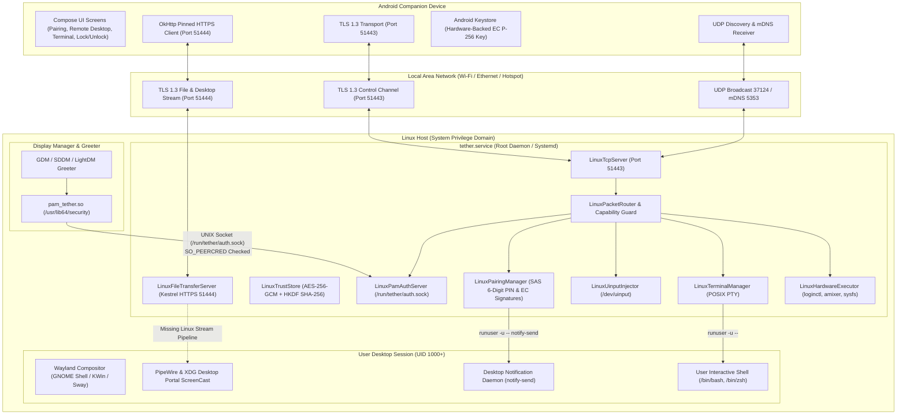

# TETHER ARCHITECTURE & PRIVILEGE BOUNDARY SPECIFICATION

**Audit Date:** 2026-11-23  
**Auditor:** Principal Security & Systems Engineer  

---

## 1. System Architecture Overview

---

## 2. End-to-End Execution Flows

### 2.1. Discovery & Network Binding
1. **UDP Discovery (`LinuxUdpDiscovery.cs`):** Binds `0.0.0.0:37124`. Listens for `"TETHER_DISCOVERY_PING"`. Returns host Device ID, Device Name, SPKI public key hash, capabilities, and port `51443`.
2. **mDNS Advertiser (`LinuxMdnsAdvertiser.cs`):** Advertises service `_tether._tcp.local` on port 51443 with TXT records.

### 2.2. TLS Connection & Cryptographic Handshake
1. **Transport Security:** `LinuxTcpServer` listens on TCP 51443. Enforces TLS 1.3 / TLS 1.2 with ECDSA P-256 self-signed certificate generated by `LinuxIdentity`.
2. **HandshakeInit Frame (0x01):** Android sends its device identifier, display name, and SPKI EC public key.
3. **Reconnection Path (Paired Device):** If the phone's SPKI is already present in `LinuxTrustStore`:
   - Daemon validates SPKI fingerprint against pinned records.
   - Requires dynamic `HandshakeProof` (0x02) signed by phone identity key over random server nonce.
   - Establishes authenticated `LinuxSession` with granted capabilities.
4. **First-Time Pairing Path (Unpaired Device):**
   - Daemon checks rate limits (< 2 pending per phone, < 32 global).
   - Generates random 6-digit PIN and UUID `requestId`.
   - Hashes handshake transcript: $H = \text{SHA-512}(\text{InitBytes} \parallel \text{ResponseBytes})$.
   - Derives AuthKey: $\text{AuthKey} = \text{HMAC-SHA256}(\text{PIN}, \text{TranscriptHash} \parallel \text{RequestId} \parallel \text{HostSPKI} \parallel \text{PhoneSPKI})$.
   - Presents PIN to local console and active user desktop via `runuser notify-send`.
   - Android client submits `PairingProof` containing `AuthKey` and phone signature.
   - Daemon verifies AuthKey (constant-time) and ECDSA signature, returns `ServerProof`, and commits record to `LinuxTrustStore`.

### 2.3. Workstation Unlock & PAM Authentication
1. **Unlock Command:** Android companion sends command `unlock` over TLS control channel.
2. **Authorization Check:** `LinuxPacketRouter` checks session capability (`POWER_ELEVATED` or `LOCK`).
3. **Grant Arming:** `LinuxPamAuthServer.ArmUnlockGrant(targetUser, deviceFingerprint, validitySeconds: 15)`.
4. **Greeter Invocation:** User approaches machine / presses key at GDM / SDDM / lock screen.
5. **PAM Module (`pam_tether.so`):**
   - Display manager invokes `pam_sm_authenticate`.
   - `pam_tether.so` connects to UNIX domain socket `/run/tether/auth.sock`.
   - Sends framing: `{"action":"AUTH_REQUEST","user":"<username>","service":"<service>"}`.
   - `LinuxPamAuthServer` verifies peer credentials (`SO_PEERCRED`), checks grant validity and target user, consumes one-time grant, and responds with `{"status":"SUCCESS"}` or `{"status":"DENIED"}`.
   - If `SUCCESS`, `pam_tether.so` returns `PAM_SUCCESS`, completing workstation unlock.

---

## 3. Trust Boundaries & Privilege Transitions

| Component | Execution Context / UID | Capabilities & Privileges | Exposed Interfaces |
| :--- | :--- | :--- | :--- |
| **`tether-daemon`** | `root` (UID 0), supplementary group `tether` | System service, full filesystem access (scoped by `tether.service`), `/dev/uinput` write, raw PTY allocation | TCP 51443 (TLS 1.3), UDP 37124, HTTPS 51444, `/run/tether/auth.sock` |
| **`pam_tether.so`** | Caller UID (e.g. `root` in `gdm-session-worker`, UID 42 in GDM greeter, or desktop user UID in screen lockers) | PAM authentication hook | In-process PAM C ABI |
| **`tetherctl` CLI** | Invoking User (UID 0 or UID 1000+) | Non-privileged user or root | Command line interface, `/run/tether/auth.sock` |
| **Terminal Shells** | Target Session User (UID 1000+) | Dropped privileges via `runuser -u <user>` | PTY stdio streams |
| **Desktop Notifications** | Target Session User (UID 1000+) | Dropped privileges via `runuser -u <user> notify-send` | D-Bus Session Bus |

---

## 4. Architectural Vulnerability & Parity Hotspots Remediated

1. **PAM Service Restriction & Privilege Hardening:** `LinuxPamAuthServer` strictly validates `service` against an explicit whitelist (`gdm-password`, `sddm`, `lightdm`, `login`, `gnome-screensaver`, `swaylock`, `hyprlock`). Non-whitelisted services (`sudo`, `sshd`, `su`) are rejected with `SERVICE_DENIED`. Local IPC `ARM_GRANT` capability has been completely eliminated from the socket interface, preventing unauthorized local processes from manufacturing grants. Local greeters and CLI can only issue `REQUEST_PHONE_AUTH` to dispatch a challenge to connected paired mobile devices.
2. **Remote Desktop Streaming Pipeline:** Implemented `LinuxDesktopManager` supporting `/api/desktop/stream` (MJPEG streaming), `/api/desktop/screenshot` (dynamic X11 geometry via `wmctrl` and honest fail-closed semantics without synthetic JPEG fallbacks), and `/api/desktop/windows` (real window enumeration).
3. **HTTP Client Proof Validation Parity:** `LinuxFileTransferServer` enforces mandatory cryptographic client-proof (`X-Tether-Client-Proof` and `X-Tether-Client-Timestamp`) across all protected routes with replay protection cache, clock-drift validation ($\pm 5$ min), and dual-format ECDSA signature verification (IEEE P1363 and DER).
4. **Uninstaller PAM Restoration:** `uninstall.sh` restores pristine `.tether-orig` backups and cleanly strips `pam_tether.so` references, preventing login lockout.
5. **Greeter Status & Interaction Architecture:** Local helper `tether-greeter` operates as a status and challenge dispatcher using `REQUEST_PHONE_AUTH`. Seamless PAM fallback to native password prompt (`PAM_AUTHINFO_UNAVAIL`) guaranteed when phone is absent or prompt is cancelled.
