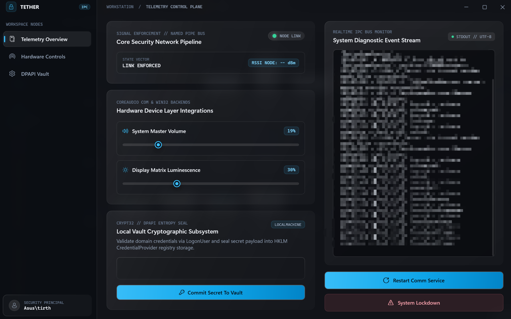
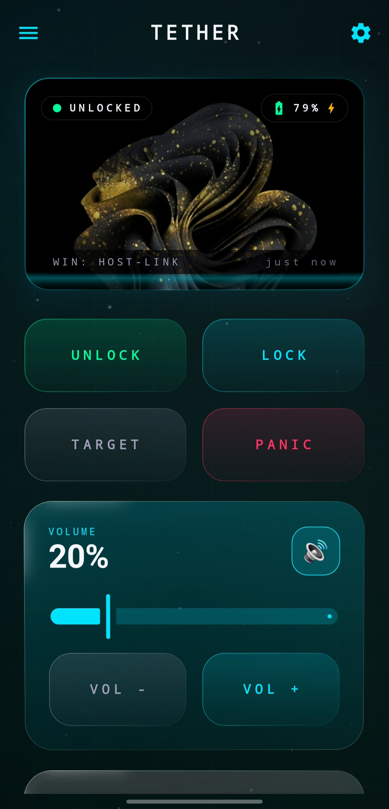
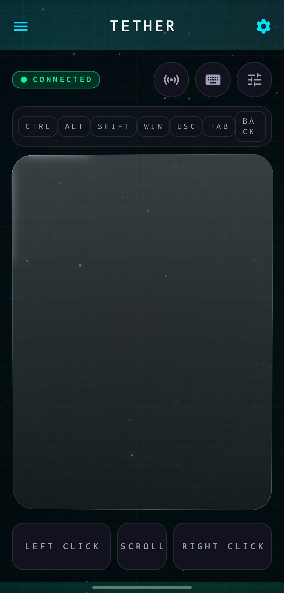
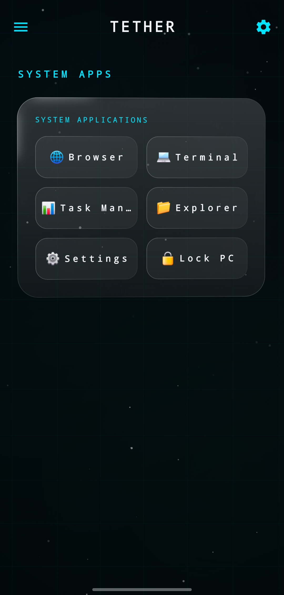
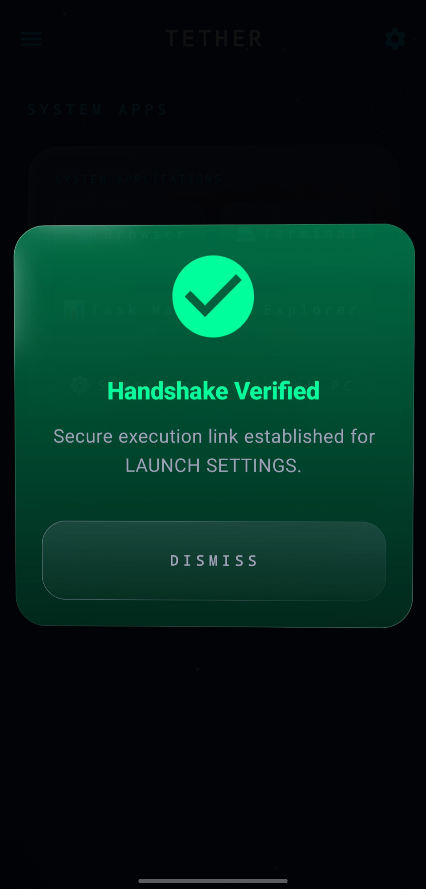
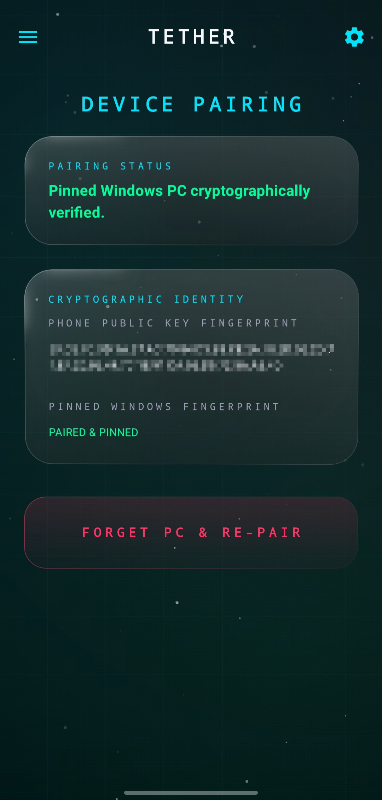
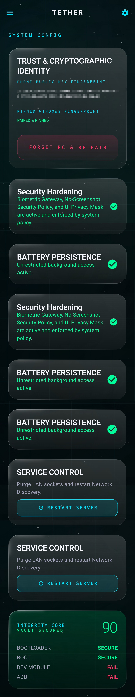
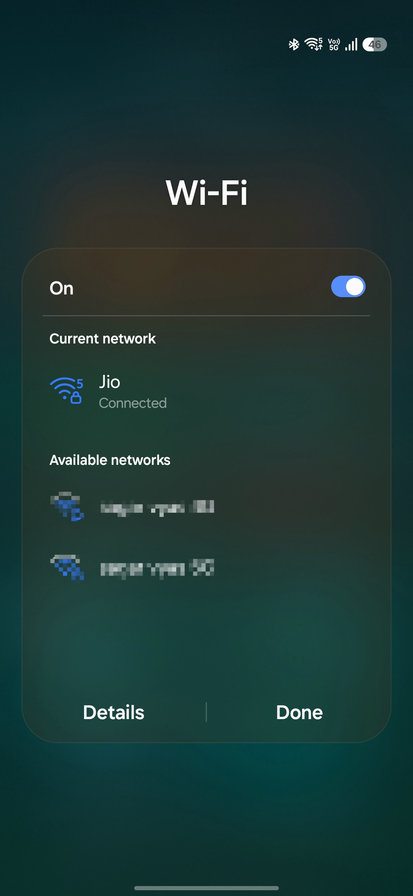

# Tether

**Adaptive personal trust and security system for Windows and Android.**

- **Platforms:** Windows and Android
- **Status:** Active Development
- **Transport:** Local Wi-Fi/LAN — TLS 1.3 over direct TCP

> [!WARNING]
> **BETA DEVELOPMENT STATUS**
>
> Tether is under active development. Do not rely on it for mission-critical production security without an independent security review. Review the [Security Model](#security-model) and the release notes before use.

## Table of Contents

- [Overview](#overview)
- [Use Cases and Value Proposition](#use-cases-and-value-proposition)
- [Key Features](#key-features)
- [Visual Highlights and UI Screenshots](#visual-highlights-and-ui-screenshots)
- [Architecture and System Design](#architecture-and-system-design)
- [Architecture Deep Dive for Contributors](#architecture-deep-dive-for-contributors)
- [Supported Platforms](#supported-platforms)
- [Prerequisites](#prerequisites)
- [Installation and Setup](#installation-and-setup)
- [Quick Start and Usage](#quick-start-and-usage)
- [Security Model](#security-model)
- [Project Structure](#project-structure)
- [Configuration](#configuration)
- [Troubleshooting and Error Matrix](#troubleshooting-and-error-matrix)
- [Roadmap](#roadmap)
- [Contributing](#contributing)
- [License](#license)
- [Acknowledgements](#acknowledgements)

---

## Overview

**Tether** is an open-source personal trust and authentication platform designed to connect an Android device with a Windows workstation. It aims to use a smartphone as a cryptographically secured **trust anchor**, enabling device-based authentication workflows, workstation locking, trust validation, emergency lockdown, and remote workstation control.

Unlike cloud-dependent companion applications, Tether is designed to communicate directly over supported local Wi-Fi/LAN infrastructure without requiring a cloud relay as part of its intended communication architecture.

### Who Is Tether For?

- **Privacy Enthusiasts:** Users who prefer local-first communication and minimal dependence on cloud infrastructure.
- **Security-Conscious Users:** Users interested in device-based authentication, cryptographic identity, and workstation security.
- **Developers and Security Researchers:** People exploring Windows Credential Providers, secure inter-process communication (IPC), Android Keystore cryptography, and cross-platform authentication.

> [!IMPORTANT]
> Tether is an early-stage project. Its authentication workflows, security properties, and failure-recovery behavior should be independently verified before it is used to protect sensitive systems.

## Use Cases and Value Proposition

- **Device-Assisted Windows Unlock:** Use an Android device as part of a supported Windows authentication workflow, where implemented by the installed release.
- **Emergency Workstation Locking:** Request an immediate workstation lock from the mobile companion application.
- **Trust Revocation:** Initiate trust-related state invalidation through supported security workflows.
- **Remote Desktop Controls:** Adjust supported PC settings, including audio volume, and invoke supported desktop actions.
- **Remote Trackpad and Input:** Control cursor movement, scrolling, clicks, and supported keyboard input from Android.
- **Local-First Connectivity:** Communicate directly over a supported local network without requiring a cloud relay.

Feature availability and behavior depend on the installed release, the Windows environment, and the Android device's capabilities.

## Key Features

### Android Trust Anchor and Pairing

- **Android Keystore Integration:** Uses Android Keystore for cryptographic key management, with hardware-backed storage or StrongBox where supported and configured.
- **RSA-2048 Key Material:** The documented implementation uses the `TetherAsymmetricKey_v3` alias for key generation and signing.
- **Local Device Discovery:** Supports mDNS discovery using `_tether._tcp.` and UDP broadcast discovery on port `37123`, where implemented and supported by the network.
- **Device Integrity Checks:** Evaluates selected security signals, including root status, developer settings, and biometric availability.
- **Persistent Device Identity:** Designed to bind paired devices to cryptographic identities for subsequent connections.

### Panic Mode and Emergency Lockdown

- **Workstation Locking:** Requests workstation locking through the configured command path.
- **Trust Revocation:** Designed to invalidate active trust relationships and associated session state.
- **Emergency Command Dispatch:** Provides a dedicated workflow for security-related commands.

The exact scope of trust revocation and session invalidation depends on the Windows-side enforcement mechanisms implemented in the installed release.

### Continuous Trust Validation

- **Connectivity Monitoring:** Uses Android connectivity callbacks to detect Wi-Fi disconnections and network changes.
- **Session Cleanup:** Designed to invalidate active session state when connectivity is lost or changes.
- **Stale Request Protection:** Uses request identifiers, timestamps, and nonces as part of command validation.

These mechanisms depend on correct validation and enforcement by the receiving Windows components.

### Windows Integration

- **Custom Credential Provider:** Native C++ Win32 Credential Provider integration through `TetherCredentialProvider`.
- **Communication Service:** `Tether.CommunicationService` handles local network communication and command dispatch.
- **Interactive Session Helper:** `Tether.SessionHelper.exe` operates in an interactive user session for supported user-session operations.
- **Desktop Configuration UI:** `Tether.DesktopUI` provides a desktop interface for configuration and device management.
- **Named-Pipe IPC:** Windows components communicate through configured inter-process communication channels.

### Remote Control and Execution

- **Audio Control:** Adjust supported Windows audio levels from Android.
- **Display Brightness:** Control display brightness through the interactive session helper where supported.
- **Remote Input:** Send supported mouse movement, clicks, scrolling, and modifier-key events.
- **Application Launching:** Request that supported Windows utilities open in the target interactive session.
- **Workstation Locking:** Initiate supported workstation-locking operations.

---

## Visual Highlights and UI Screenshots

The following screenshots showcase Tether's Windows management interface, Android companion application, remote-control functionality, and device-trust workflows.

**Screenshot directory:** `docs/assets/screenshots/`

### Workstation Control Plane

The Windows desktop interface provides IPC diagnostics, system audio and display-brightness controls, and DPAPI-backed local vault integration.

<p align="center">
  
</p>

<p align="center">
  <em><strong>Desktop Telemetry Control Plane</strong> — IPC diagnostic event stream, Core Audio and display-brightness integrations, and DPAPI-backed local vault subsystem.</em>
</p>

### Mobile Command and Input Experience

<table>
  <tr>
    <td width="50%" align="center" valign="top">
      
      <br /><br />
      <strong>Mobile Trust Command Center</strong>
      <p>Workstation connection status, lock and unlock controls, emergency lockdown, and audio controls.</p>
    </td>
    <td width="50%" align="center" valign="top">
      
      <br /><br />
      <strong>Remote Trackpad</strong>
      <p>Cursor movement, scrolling, and supported Windows modifier-key input.</p>
    </td>
  </tr>
</table>

### Remote Execution and Handshake Security

<table>
  <tr>
    <td width="50%" align="center" valign="top">
      
      <br /><br />
      <strong>System Application Launcher</strong>
      <p>Session-aware requests to launch supported utilities, including Terminal, Task Manager, File Explorer, and Windows Settings.</p>
    </td>
    <td width="50%" align="center" valign="top">
      
      <br /><br />
      <strong>Handshake Verification</strong>
      <p>Connection verification and authorization-state checks before sensitive command dispatch.</p>
    </td>
  </tr>
</table>

### Identity Pinning and Device Integrity

<table>
  <tr>
    <td width="50%" align="center" valign="top">
      
      <br /><br />
      <strong>Cryptographic Device Pairing</strong>
      <p>Public-key fingerprint verification and persistent identity binding between Android and Windows.</p>
    </td>
    <td width="50%" align="center" valign="top">
      
      <br /><br />
      <strong>Device Integrity and Policy Configuration</strong>
      <p>Device-security signals, runtime policies, and socket-daemon controls.</p>
    </td>
  </tr>
</table>

### Local Network Connectivity

<p align="center">
  
</p>

<p align="center">
  <em><strong>Local Network Boundary</strong> — Designed for direct communication between paired devices on a supported local Wi-Fi/LAN network.</em>
</p>

---

## Architecture and System Design

Tether connects an Android companion application to a Windows workstation through a modular, local-network communication architecture. Its components cover device discovery, cryptographic pairing, secure sessions, command routing, workstation control, and trust enforcement.

Explore the repository architecture using GitDiagram:

[](https://gitdiagram.com/tirthsaraiya29/tether?utm_source=readme&utm_medium=badge)

### Network Design Principles

- **Transport:** TLS 1.3 over direct TCP.
- **Default Communication Port:** `37123`.
- **Discovery:** mDNS and UDP broadcast, where implemented and supported.
- **Cloud Relay:** Not required by the intended local-network architecture.
- **BLE:** Not used as the command transport in the documented design.
- **Mobile Hotspot:** Unsupported by the intended network configuration.

Local-only operation reduces dependence on external infrastructure but does not inherently protect Tether against malicious devices on the same network.

### Architectural Source References

The following paths identify representative implementation files in the repository. Verify the paths against the current branch before relying on them.

| Component | Source File |
|---|---|
| Android mobile controls | [`MainScreens.kt`](apps/android-companion/app/src/main/java/com/tether/phone/ui/screens/MainScreens.kt) |
| Android remote input | [`RemoteInputScreen.kt`](apps/android-companion/app/src/main/java/com/tether/phone/ui/screens/RemoteInputScreen.kt) |
| Android LAN service | [`TetherLanService.kt`](apps/android-companion/app/src/main/java/com/tether/phone/TetherLanService.kt) |
| Android security engine | [`ProductionSecurityEngine.kt`](apps/android-companion/app/src/main/java/com/tether/phone/ProductionSecurityEngine.kt) |
| Android discovery | [`TetherDiscoveryManager.kt`](apps/android-companion/app/src/main/java/com/tether/phone/TetherDiscoveryManager.kt) |
| Android pairing | [`TetherPairingManager.kt`](apps/android-companion/app/src/main/java/com/tether/phone/TetherPairingManager.kt) |
| TCP server | [`TetherTcpServer.cs`](services/communication-service/Tether.CommunicationService/Transport/TetherTcpServer.cs) |
| Secure session | [`TetherSession.cs`](services/communication-service/Tether.CommunicationService/Transport/TetherSession.cs) |
| Session manager | [`SessionManager.cs`](services/communication-service/Tether.CommunicationService/Sessions/SessionManager.cs) |
| Packet router | [`PacketRouter.cs`](services/communication-service/Tether.CommunicationService/Protocol/PacketRouter.cs) |
| Windows pairing | [`PairingManager.cs`](services/communication-service/Tether.CommunicationService/Pairing/PairingManager.cs) |
| Device manager | [`DeviceManager.cs`](services/communication-service/Tether.CommunicationService/Devices/DeviceManager.cs) |
| Trusted-device store | [`TrustStore.cs`](services/communication-service/Tether.CommunicationService/Trust/TrustStore.cs) |
| Capability manager | [`CapabilityManager.cs`](services/communication-service/Tether.CommunicationService/Capabilities/CapabilityManager.cs) |
| Hardware executor | [`HardwareExecutor.cs`](services/communication-service/Tether.CommunicationService/Capabilities/HardwareExecutor.cs) |
| Laptop state collector | [`LaptopStateCollector.cs`](services/communication-service/Tether.CommunicationService/Capabilities/LaptopStateCollector.cs) |
| Session helper | [`Program.cs`](services/communication-service/Tether.SessionHelper/Program.cs) |
| Event bus | [`InMemoryEventBus.cs`](services/event-bus/Tether.EventBus/InMemoryEventBus.cs) |
| Shared trust events | [`TetherEvent.cs`](shared/Tether.Shared/Events/TetherEvent.cs) |
| Trust-state manager | [`TrustStateManager.cs`](services/trust-engine/Tether.TrustEngine/TrustStateManager.cs) |
| Panic manager | [`PanicManager.cs`](services/panic-engine/Tether.PanicEngine/PanicManager.cs) |
| Enforcement manager | [`EnforcementManager.cs`](services/enforcement-engine/Tether.EnforcementEngine/EnforcementManager.cs) |
| Desktop configuration UI | [`MainWindow.xaml.cs`](apps/desktop-ui/Tether.DesktopUI/MainWindow.xaml.cs) |

---

## Architecture Deep Dive for Contributors

This section provides additional context for developers and security researchers. It is not required for a standard installation.

### Windows Session 0 Isolation and Session Helper

Windows services run in Session 0, which is isolated from interactive desktop user sessions.

To interact with resources in an active user session, the Windows-side implementation may use a workflow involving:

1. Querying the active console session with `WTSGetActiveConsoleSessionId()`.
2. Obtaining an appropriate user token through `WTSQueryUserToken()`.
3. Duplicating a token through `DuplicateTokenEx()`, subject to Windows security requirements.
4. Launching `Tether.SessionHelper.exe` in the intended interactive session using `CreateProcessAsUser()`.

These APIs require appropriate privileges and careful handling of access tokens. Token duplication and process creation must be restricted to the intended session and security context.

**Security boundary:** The session helper should not be treated as a security boundary merely because it runs outside Session 0. Its privileges, executable integrity, IPC authorization, and permitted operations must be reviewed together.

### Named-Pipe IPC Mapping

Windows components use named pipes for inter-process communication. The following names describe the intended roles of the documented IPC channels:

- **`TetherPipe`:** Service-to-desktop-UI control and event channel, associated with `Tether.Shared.IPC.IpcConstants.PipeName`.
- **`TetherUiPipe`:** Service-to-desktop-UI diagnostics relay, associated with `IpcConstants.UiPipeName`.
- **`Tether.InputPipe`:** Communication-service-to-session-helper stream for supported remote input events.

The actual pipe names, ACLs, client authentication, and message formats should be verified against the current implementation.

A security review should examine:

- Named-pipe ACLs and client identity validation.
- Message framing and input validation.
- Authorization for sensitive operations.
- Impersonation and token-handling behavior.
- Service-to-helper trust boundaries.
- Resistance to pipe squatting and unauthorized pipe creation.
- Failure handling and cleanup when clients disconnect.

### Testing

Tether includes or has planned testing infrastructure for Windows and Android components, including Android unit tests, Windows solution tests, and an IPC pipe test utility where implemented.

Test coverage and test results vary by branch and release. Consult the repository's current test projects and CI workflows rather than assuming every component is covered by automated integration tests.

---

## Supported Platforms

The following table describes the intended platform targets. Check the release notes for the actual compatibility of published binaries.

| Platform | Target Version | Architecture | Technology |
|---|---|---|---|
| Windows | Windows 10 / 11 | x64 | .NET 10, C++, Win32 APIs |
| Android | Android 12 (API 31) and later | ARM64 / x86_64, as packaged | Kotlin, Jetpack Compose |

**Windows compatibility** depends on the APIs, runtime, operating-system build, and installer requirements of the published release.

**Android compatibility** depends on the APK's minimum SDK, target SDK, available hardware features, and required permissions.

The listed targets are not a guarantee that every feature works on every supported device.

---

## Prerequisites

For a standard installation, use the prebuilt release artifacts when available. You do not need to clone the repository or compile the applications manually.

You need:

- A supported Windows 10 or Windows 11 x64 workstation.
- A compatible Android device running a supported Android version.
- A supported local Wi-Fi/LAN network accessible to both devices.
- The Windows installer and Android APK from compatible Tether releases, if both are published.
- Windows administrator access if required by the installer.
- An existing, tested alternative method of signing in to Windows.

Review the release notes for version-specific requirements, known limitations, and installation instructions.

---

## Installation and Setup

The recommended installation method is to download the prebuilt binaries from the official GitHub Releases page.

[**Download Tether from GitHub Releases**](https://github.com/tirthsaraiya29/Tether/releases)

### 1. Download the Release

1. Open the [Tether Releases page](https://github.com/tirthsaraiya29/Tether/releases).
2. Select the release you want to install.
3. Review its release notes and compatibility information.
4. Download the Windows installer (`Tether-Setup-*.exe`) and Android companion APK if they are attached to that release.
5. Confirm that both artifacts belong to compatible release versions.

Tether is under active development, and releases may be marked as prereleases. Prefer a stable release when one is available and suitable for your needs.

Download installation files only from the official project release page.

### 2. Prepare Your Windows Account

Before installing or configuring authentication:

1. Confirm that you can sign in to Windows using your existing authentication method.
2. Keep your account recovery options available.
3. Follow the account setup instructions for your specific Tether release.
4. Make sure you know how to recover access if the Tether authentication workflow fails.

> [!WARNING]
> Do not disable existing sign-in methods or make Tether your only way to access Windows. Maintain a separate administrator account or another tested recovery path.

Windows Hello behavior varies by account type and Windows configuration. Do not assume that enabling a particular sign-in option disables password sign-in for every account.

Entering a Windows password into an application does not, by itself, establish that Windows will authenticate through its Credential Provider or that a session can be unlocked safely.

### 3. Install Tether on Windows

1. Locate the downloaded Windows installer.
2. Run the installer and approve administrator access if requested.
3. Follow the installation wizard.
4. Allow the installer to configure the Windows service, Credential Provider integration, and firewall rules if those components are included in the release.
5. Complete the installation and launch Tether Desktop UI if it is provided as a separate application.

Do not manually register DLLs or modify Windows logon configuration unless the official instructions for your specific release explicitly require it.

### 4. Install Tether on Android

1. Locate the Android companion APK downloaded from the release.
2. Open the APK on your Android device.
3. If Android requests permission to install apps from that source, review the request and grant permission only if you trust the downloaded file.
4. Complete the installation.
5. Launch Tether and grant the permissions required by the features you intend to use.

After installation, you can revoke the permission to install unknown apps for that source in Android settings if desired.

### 5. Pair Your Devices

1. Connect the Windows PC and Android device to the same supported local Wi-Fi network.
2. Launch Tether Desktop UI on Windows and leave it running if required by your release.
3. Open the Tether companion app on Android.
4. Follow the pairing instructions displayed by the applications.
5. Enter the pairing code displayed by the desktop application if prompted.
6. Complete any additional authentication or credential configuration required by the installed release.
7. Wait for the applications to confirm that pairing or connection has completed.

Tether is designed for local Wi-Fi/LAN communication. Mobile hotspot configurations, unsupported routing arrangements, and public WAN exposure are outside the intended network model.

### 6. Verify the Installation

Before relying on Tether:

- Confirm that the Windows communication service is running.
- Confirm that the Android application reports a successful connection or pairing.
- Test workstation locking and any other features you intend to use.
- Verify the intended authentication workflow using the instructions for your installed release.
- Confirm that you can still sign in to Windows using your alternative recovery method.

If a step fails, consult the [Troubleshooting and Error Matrix](#troubleshooting-and-error-matrix) and the release notes for the installed version.

---

## Quick Start and Usage

For the quickest supported setup:

1. Download the Windows installer and Android APK from [GitHub Releases](https://github.com/tirthsaraiya29/Tether/releases).
2. Install Tether on Windows.
3. Install the companion app on Android.
4. Connect both devices to the same supported local Wi-Fi network.
5. Open Tether Desktop UI and launch the Android companion app.
6. Complete pairing and verify the connection.
7. Test the enabled features and your Windows recovery method.

### Network Requirements

| Requirement | Expected Configuration |
|---|---|
| Windows PC and Android device | Same supported local Wi-Fi/LAN |
| Communication transport | TLS 1.3 over TCP |
| Default communication port | `37123` |
| Service discovery | mDNS / UDP broadcast, where supported |
| Cloud relay | Not required by the intended architecture |
| Mobile hotspot | Unsupported |

If discovery fails, check the Windows firewall and local network configuration before changing system security settings.

### Common Actions

| Action | Mobile Workflow | Expected Result |
|---|---|---|
| **Unlock PC** | Follow the supported unlock workflow and complete biometric verification if prompted. | Initiates the configured Windows authentication workflow where supported. |
| **Lock PC** | Tap `LOCK`, if available in your release. | Requests that the interactive Windows session lock. |
| **Panic** | Tap `PANIC`, if available in your release. | Initiates the implemented emergency-lockdown workflow. |
| **Trackpad** | Swipe on the trackpad surface. | Sends supported cursor movement commands to Windows. |
| **Launch App** | Select a supported utility, such as Terminal or Task Manager. | Requests that the selected utility open in the target user session. |
| **Audio Control** | Adjust the audio slider. | Updates the supported Windows audio level. |

Exact behavior depends on the installed build, Windows session state, permissions, and implemented functionality.

---

## Security Model

Tether is designed around local networking, device-based cryptographic identity, replay protection, and explicit trust validation. These design goals should not be interpreted as proof that the current implementation is secure against every threat.

### 1. TLS 1.3 and Cryptographic Handshake

- **TLS 1.3 Transport:** Intended to protect command and state traffic over direct TCP on port `37123`.
- **RSA-2048 Key Material:** The documented pairing design uses RSA public-key material and cryptographically random nonces, including `phoneNonce` and `windowsNonce`.
- **Android Keystore:** Private keys are intended to remain within Android Keystore, with StrongBox used where supported and configured.
- **Peer Authentication:** Device identity and pairing state must be validated in addition to establishing an encrypted connection.

TLS encryption alone does not guarantee that the correct device has been authenticated. Certificate or public-key validation, key provisioning, and pairing verification are essential.

### 2. Local Infrastructure Boundary and Threat Isolation

- **Local Network Constraint:** Both devices are intended to communicate over the same supported Wi-Fi/LAN infrastructure.
- **No Required Cloud Relay:** The intended architecture does not require a cloud relay.
- **Hotspot Rejection:** The Android application is designed to reject unsupported hotspot/tethering configurations.
- **Firewall Controls:** Network access should be restricted to the required local communication paths.

A local network is not inherently trusted. Other devices on the same network may be hostile, and local-only operation does not eliminate spoofing, compromised-router, or malicious-client risks.

### 3. Replay Protection and Session Hardening

- **Unique Request IDs:** Command payloads include a unique `requestId`.
- **Timestamp Validation:** Requests include timestamps intended to support freshness validation.
- **Nonce Validation:** Nonces can help prevent replay when correctly validated and tracked.
- **Session Cleanup:** Active session state is intended to be invalidated when network connectivity is lost or changes.

Replay protection requires server-side freshness checks, appropriate nonce tracking, and correct handling of duplicate or out-of-order messages. Including these fields in a request is not sufficient by itself.

### 4. On-Device Integrity Checks

The `DeviceIntegrityRegistry` is intended to evaluate selected device-security signals, such as root status, developer options, and biometric availability.

These signals are indicators, not conclusive proof of device integrity. Root detection and developer-setting checks can be bypassed and must not be treated as substitutes for robust authentication.

### 5. Windows Privilege Boundaries

Tether includes Windows services, an interactive session helper, IPC mechanisms, and Credential Provider integration.

These components operate across different Windows security contexts and require careful review of:

- Service privileges and access-token handling.
- Named-pipe ACLs and message validation.
- Credential Provider authentication and recovery behavior.
- Authorization of remote input and workstation commands.
- Session invalidation and emergency-lockdown enforcement.
- Installer integrity and secure update procedures.
- Isolation between Session 0 services and interactive user sessions.
- Resistance to privilege escalation and unauthorized SYSTEM-level operations.

A service running as `SYSTEM` must not automatically trust commands from an interactive process or a paired device. Sensitive operations require explicit authorization, strict input validation, and carefully enforced privilege boundaries.

### 6. Security Limitations

Tether is under active development. Before using it to protect sensitive systems, independently assess its cryptographic protocol, Windows logon integration, privilege boundaries, recovery behavior, and failure modes.

**Do not treat Tether as a replacement for established Windows authentication and endpoint security controls until the relevant implementation has been reviewed and validated.**

---

## Project Structure

The following structure describes the main source-code components. The contents of an installed release may differ from the repository layout.

```text
Tether/
├── Tether.slnx
├── TetherCredentialProvider/       # Native C++ Win32 Credential Provider
├── apps/
│   ├── android-companion/           # Kotlin / Jetpack Compose Android client
│   └── desktop-ui/                  # Windows desktop management UI
├── services/
│   ├── communication-service/
│   │   ├── Tether.CommunicationService/
│   │   └── Tether.SessionHelper/
│   ├── enforcement-engine/
│   ├── event-bus/
│   ├── panic-engine/
│   ├── recovery-engine/
│   └── trust-engine/
├── shared/
│   └── Tether.Shared/
└── tests/
    └── PipeTest/
````

### Component Overview

| Component                   | Responsibility                                       |
| --------------------------- | ---------------------------------------------------- |
| TetherCredentialProvider    | Native Windows logon integration                     |
| Tether.CommunicationService | Local TCP communication and command dispatch         |
| Tether.SessionHelper        | Interactive user-session integration                 |
| Tether.TrustEngine          | Trust validation and state management                |
| Tether.PanicEngine          | Emergency-lockdown workflows                         |
| Tether.RecoveryEngine       | Recovery-related workflows                           |
| Tether.EnforcementEngine    | Enforcement and policy handling                      |
| Tether.Shared               | Shared data structures, IPC constants, and utilities |
| Android companion           | Device pairing and mobile-side controls              |
| Desktop UI                  | Windows configuration and device management          |

### Configuration

Windows service and desktop settings may be configured through `appsettings.json` files in the relevant application directories.

| Setting                | Default or Intended Value |
| ---------------------- | ------------------------- |
| TCP communication port | 37123                     |
| mDNS service type      | _tether._tcp.             |
| Network scope          | Supported local Wi-Fi/LAN |
| Transport security     | TLS 1.3                   |

Actual configuration options depend on the installed release and the configuration supported by each component.

For normal installations, use the application interface and installer-provided defaults where available. Avoid editing service configuration or changing firewall rules manually unless the release documentation instructs you to do so.

> \[!WARNING\] Do not expose Tether's communication port to the public internet or configure router port forwarding for Tether. Its intended network model is local-only.

### Troubleshooting and Error Matrix

| Error or Symptom             | Possible Cause                                                                                            | Recommended Resolution                                                                                            |
| ---------------------------- | --------------------------------------------------------------------------------------------------------- | ----------------------------------------------------------------------------------------------------------------- |
| HOTSPOT_UNSUPPORTED          | The phone is operating in an unsupported hotspot/tethering configuration.                                 | Connect both devices as clients to the same supported Wi-Fi router.                                               |
| DISCOVERY_FAILED             | mDNS or UDP broadcast is blocked, unsupported, or unavailable on the network.                             | Check that both devices share the same LAN and that local discovery traffic is permitted.                         |
| Connection timeout           | The Windows service is stopped, the devices are on different networks, or the port is blocked.            | Verify Windows service status, Wi-Fi connectivity, and local firewall configuration.                              |
| TLS handshake failure        | Protocol, certificate, key, or peer-validation mismatch.                                                  | Confirm that both applications come from compatible releases and repeat pairing using the documented workflow.    |
| HELPER_NOT_FOUND             | The session helper is missing or was not installed correctly.                                             | Repair or reinstall Tether using the official Windows installer for the matching release.                         |
| BIOMETRIC_FAILED             | Biometric hardware is unavailable, not configured, or the requested operation is unsupported.             | Configure a supported device lock and biometric method, then retry.                                               |
| Pairing code rejected        | The code is incorrect, expired, or associated with another pairing attempt.                               | Generate a new pairing code and repeat the documented pairing workflow.                                           |
| Windows authentication fails | Credential Provider integration or the configured authentication workflow is not functioning as expected. | Use your established Windows recovery method and consult the release notes. Do not disable other sign-in options. |
| Remote input does not work   | Required permissions, the session helper, or the input channel may be unavailable.                        | Verify service status and confirm that the feature is supported by your release.                                  |

If a problem persists, report it through the [GitHub issue tracker](https://github.com/tirthsaraiya29/Tether/issues?utm_source=chatgpt.com) with the Tether release version, Windows version, Android version, relevant logs, and reproduction steps.

Remove passwords, private keys, pairing secrets, access tokens, and other sensitive information before sharing logs.

### Roadmap

Potential future improvements include:

* Hardware security key support through FIDO2/WebAuthn integration.

* Expanded biometric-confirmation workflows on Android.

* Multi-device management in `Tether.DesktopUI`.

* Comprehensive automated integration testing.

* Further hardening of authentication and session recovery.

* Improved release verification and installation documentation.

* More detailed security documentation and independent review.

* Additional reliability testing for network loss, reconnection, and workstation state transitions.

Roadmap items are subject to change and are not guarantees of delivery. An unchecked item should not be interpreted as implemented functionality.

### Contributing

Contributions and technical feedback are welcome from developers and security researchers.

### Development Workflow

* Fork the [Tether repository](https://github.com/tirthsaraiya29/Tether?utm_source=chatgpt.com).

* Create a feature branch.

* Make your changes while preserving the documented transport design and security boundaries.

* Add or update tests relevant to your changes.

* Run the applicable builds and tests.

* Commit and push your branch.

* Open a pull request describing the changes, validation performed, and any security implications.

Please use the [GitHub issue tracker](https://github.com/tirthsaraiya29/Tether/issues?utm_source=chatgpt.com) to discuss significant architectural changes before submitting a pull request.

Development may require platform-specific SDKs, compilers, and tools. These are intended for contributors and are not required for users installing published releases.

### Security Contributions

Security improvements should include a clear explanation of the threat being addressed, the affected trust boundary, the proposed mitigation, and the tests used to validate the change.

For vulnerabilities that could expose credentials, enable unauthorized access, or permit privilege escalation, use GitHub's private vulnerability-reporting mechanism if it is enabled for the repository. Avoid publishing exploitable details before maintainers have had a reasonable opportunity to investigate.

### License

Tether's original code is intended to be distributed under the GNU General Public License v3.0 only (`GPL-3.0-only`).

See the repository's `LICENSE` file for the applicable license terms. The license file in the repository is authoritative for the project's actual licensing status.

This licensing statement applies to original Tether code for which the project has the necessary rights to grant the license. Third-party dependencies, libraries, tools, and incorporated components remain subject to their respective licenses and notices.

For the license text, see the [GNU General Public License v3.0](https://www.gnu.org/licenses/gpl-3.0.html?utm_source=chatgpt.com).

### Acknowledgements

Tether builds on technologies and concepts including:

* [.NET](https://dotnet.microsoft.com/?utm_source=chatgpt.com)

* [C++ and Win32 APIs](https://learn.microsoft.com/en-us/windows/win32/?utm_source=chatgpt.com)

* [Kotlin](https://kotlinlang.org/?utm_source=chatgpt.com)

* [Jetpack Compose](https://developer.android.com/jetpack/compose?utm_source=chatgpt.com)

* [Android Keystore](https://developer.android.com/privacy-and-security/keystore?utm_source=chatgpt.com)

* [Bouncy Castle](https://www.bouncycastle.org/?utm_source=chatgpt.com)

The project is inspired by zero-trust security principles, device-based authentication, and local-first software design.

Repository: [github.com/tirthsaraiya29/Tether](https://github.com/tirthsaraiya29/Tether?utm_source=chatgpt.com)

Releases: [Tether Releases and Changelog](https://github.com/tirthsaraiya29/Tether/releases?utm_source=chatgpt.com)

Issues and Contributions: [GitHub Issues](https://github.com/tirthsaraiya29/Tether/issues?utm_source=chatgpt.com)
