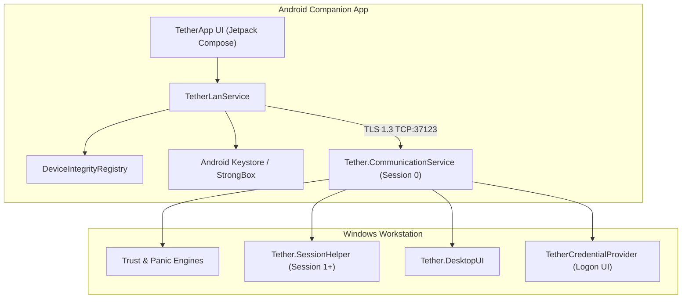

# Tether

**Adaptive personal trust and security system for Windows and Android.**

- **Platform:** Windows | Android
- **Status:** Canary — Active Development
- **Transport:** Local Wi-Fi / LAN only (TLS 1.3 over direct TCP)

---

> [!WARNING]
> **BETA DEVELOPMENT STATUS**
>
> Tether is under active development. It should not be relied upon for mission-critical production security environments without an independent security review. Review the [Security Model](#security-model) and the release notes before use.

---

## Table of Contents

- [Overview](#overview)
- [Use Cases & Value Proposition](#use-cases--value-proposition)
- [Key Features](#key-features)
- [Visual Highlights & UI Screenshots](#visual-highlights--ui-screenshots)
- [Architecture & System Design](#architecture--system-design)
- [Architecture Deep-Dive for Contributors](#architecture-deep-dive-for-contributors)
- [Supported Platforms](#supported-platforms)
- [Prerequisites](#prerequisites)
- [Installation & Setup](#installation--setup)
- [Quick Start & Usage](#quick-start--usage)
- [Security Model](#security-model)
- [Project Structure](#project-structure)
- [Configuration](#configuration)
- [Troubleshooting & Error Matrix](#troubleshooting--error-matrix)
- [Roadmap](#roadmap)
- [Contributing](#contributing)
- [License](#license)
- [Acknowledgements](#acknowledgements)

---

## Overview

**Tether** is an open-source personal trust and authentication platform designed to connect an Android device with a Windows workstation. It aims to transform a smartphone into a cryptographically secured **trust anchor**, enabling proximity-aware authentication, continuous trust validation, workstation locking, emergency lockdown workflows, hardware-backed credential integration, and remote input control.

Unlike cloud-dependent companion applications, Tether is designed to operate over local Wi-Fi/LAN infrastructure without requiring cloud relays or third-party telemetry as part of its intended communication architecture.

### Who Is Tether For?

- **Privacy Enthusiasts:** Users who prefer local-only communication and minimal reliance on cloud infrastructure.
- **Security-Conscious Professionals:** Users interested in device-based trust validation, hardware-backed key storage, and emergency workstation locking.
- **Developers & Security Researchers:** Contributors exploring Windows Credential Providers, secure inter-process communication, Android Keystore cryptography, and cross-platform authentication.

> **Important:** Tether is currently a Canary-stage project. Its security properties and authentication workflows should be independently verified before being used to protect sensitive systems.

---

## Use Cases & Value Proposition

- **Biometric-Assisted Windows Unlock:** Use an Android device's biometric authentication as part of a device-based Windows authentication workflow, where supported by the installed release.
- **Emergency Panic Button:** Trigger workstation locking and trust revocation from the mobile companion app.
- **Remote Desktop Controls:** Adjust supported PC settings, such as audio volume and screen brightness, or invoke supported desktop actions.
- **Remote Trackpad & Input:** Control cursor movement, scrolling, and supported input actions from the Android device.
- **Local-First Connectivity:** Communicate directly over a supported local network without requiring a cloud relay.

Feature availability depends on the installed release and the capabilities of the Windows workstation and Android device.

---

## Key Features

### Android Trust Anchor & Pairing

- **Hardware-Backed Cryptography:** Uses Android Keystore and, where available and supported, StrongBox for RSA-2048 key generation and signing with the `TetherAsymmetricKey_v3` alias.
- **Local Device Discovery:** Supports mDNS discovery using `_tether._tcp.` and UDP broadcast discovery on port `37123`, where implemented and supported by the network.
- **Hotspot Rejection:** Designed to reject unsupported mobile hotspot or tethering configurations.
- **Device Integrity Checks:** Evaluates selected device integrity signals, root status, developer settings, and biometric availability before authorizing supported operations.

### Panic Mode & Emergency Lockdown

- **Workstation Locking:** Requests workstation locking through the configured command path.
- **Trust Revocation:** Designed to revoke active trust relationships and invalidate associated session state.
- **Emergency Command Dispatch:** Provides a dedicated workflow for dispatching security-related commands.

The exact scope and effectiveness of session invalidation depend on the implemented Windows enforcement mechanisms.

### Continuous Trust Validation

- **Connectivity Monitoring:** Uses Android connectivity callbacks to detect Wi-Fi disconnections and network changes.
- **Session Cleanup:** Designed to invalidate active session state when network connectivity is lost or changes.
- **Stale Session Protection:** Uses request identifiers, timestamps, and nonces as part of command validation.

These mechanisms depend on correct implementation and enforcement by the receiving Windows components.

### Windows Integration

- **Custom Credential Provider:** Native C++ Win32 Credential Provider integration through `TetherCredentialProvider`.
- **Communication Service:** `Tether.CommunicationService` handles local network communication and command dispatch.
- **Session Helper:** `Tether.SessionHelper.exe` operates in an interactive user session to access supported user-session resources.
- **Desktop Configuration UI:** `Tether.DesktopUI` provides a desktop interface for configuration and device management.

### Remote Control & Execution

- **Audio Control:** Adjust supported Windows audio levels from the Android companion app.
- **Display Brightness:** Control display brightness through the interactive session helper where supported.
- **Remote Input:** Emulate supported mouse movement, clicks, scrolling, and modifier key events.
- **Application Launching:** Request the launch of supported Windows utilities in the target interactive session.

---

## Visual Highlights & UI Screenshots

The following screenshots showcase Tether's Windows management interface, Android companion application, remote-control functionality, and device trust workflows.

**Screenshot directory:** `docs/assets/screenshots/`

### Workstation Control Plane

The Windows desktop manager provides IPC diagnostics, system volume and display brightness controls, and DPAPI-backed local vault integration.

<p align="center">
  
</p>

<p align="center">
  <em><strong>Desktop Telemetry Control Plane</strong> — Real-time IPC diagnostic event stream, CoreAudio and display brightness integrations, and DPAPI-backed local vault subsystem.</em>
</p>

---

### Mobile Command & Input Experience

<table>
  <tr>
    <td width="50%" align="center" valign="top">
      
      <br /><br />
      <strong>Mobile Trust Command Center</strong>
      <p>Workstation connection telemetry, one-tap lock and unlock controls, emergency panic lockdown, and real-time audio gain sliders.</p>
    </td>
    <td width="50%" align="center" valign="top">
      
      <br /><br />
      <strong>Low-Latency Precision Trackpad</strong>
      <p>Responsive cursor control, dedicated scrolling, and Windows modifier key emulation for Ctrl, Alt, Shift, Win, and Esc.</p>
    </td>
  </tr>
</table>

---

### Remote Execution & Handshake Security

<table>
  <tr>
    <td width="50%" align="center" valign="top">
      
      <br /><br />
      <strong>Privileged Application Launcher</strong>
      <p>Session-aware dispatch for Terminal, Task Manager, File Explorer, and Windows Settings in the target interactive session.</p>
    </td>
    <td width="50%" align="center" valign="top">
      
      <br /><br />
      <strong>Cryptographic Handshake Verification</strong>
      <p>TLS 1.3 connection verification and authorization-state checks before sensitive IPC command dispatch.</p>
    </td>
  </tr>
</table>

---

### Identity Pinning & Device Integrity Core

<table>
  <tr>
    <td width="50%" align="center" valign="top">
      
      <br /><br />
      <strong>Cryptographic Device Pinning</strong>
      <p>Public-key fingerprint verification and persistent identity binding between the Android device and Windows workstation.</p>
    </td>
    <td width="50%" align="center" valign="top">
      
      <br /><br />
      <strong>Device Integrity Core & Policy Matrix</strong>
      <p>Device integrity checks covering bootloader, root, and ADB states, alongside runtime security policies and socket daemon controls.</p>
    </td>
  </tr>
</table>

---

### Local Network Connectivity

<p align="center">
  
</p>

<p align="center">
  <em><strong>Zero-Cloud Local Subnet Boundary</strong> — Designed for direct communication between paired devices on a supported local Wi-Fi/LAN network.</em>
</p>

---

## Architecture & System Design

Tether consists of an Android companion application communicating with a modular Windows service suite and native Windows components over a local TLS 1.3 TCP connection.



### ASCII Architecture Overview

```text
Android Tether App (Kotlin / Jetpack Compose)
│
│ Local Wi-Fi / LAN
│ TLS 1.3 Direct TCP Socket on Port 37123
▼
Tether Windows Communication Service
(Tether.CommunicationService - Session 0)
├── Trust Engine (Tether.TrustEngine)
├── Panic Engine (Tether.PanicEngine)
├── Recovery Engine (Tether.RecoveryEngine)
├── Enforcement Engine (Tether.EnforcementEngine)
└── Session Helper (Tether.SessionHelper - Session 1+)
    ├── Audio & Brightness Controller
    ├── Lock State Detector
    ├── Input Injection Pipeline (Mouse / Modifiers)
    └── TetherCredentialProvider (Win32 Logon UI)
```

### Network Design Principles

- **BLE:** Not used as the command transport.
- **Internet:** Not required for intended local operation.
- **Cloud Relay:** Not part of the intended architecture.
- **Mobile Hotspot:** Unsupported.
- **Local TCP Port:** `37123`.
- **Service Discovery:** mDNS and UDP broadcast, where supported.

Local-only operation reduces dependence on external infrastructure but does not, by itself, guarantee protection against malicious devices on the same network.

---

## Architecture Deep-Dive for Contributors

This section describes the internal design for developers and security researchers. It is not required for a standard installation.

### Windows Session 0 Isolation & Session Helper

Windows services run in Session 0, which is isolated from interactive desktop user sessions.

To interact with resources in an active user session, the communication service is designed to:

1. Query the active console session using `WTSGetActiveConsoleSessionId()`.
2. Obtain the appropriate user token through `WTSQueryUserToken()`.
3. Duplicate the token using `DuplicateTokenEx()`, subject to Windows security requirements.
4. Launch `Tether.SessionHelper.exe` in the target interactive session using `CreateProcessAsUser()`.

These operations require appropriate privileges and careful handling of Windows access tokens. Token duplication must be restricted to the intended session and security context.

### Named Pipe IPC Mapping

Communication between Windows processes uses named pipes with access controls intended to restrict unauthorized access.

- **`TetherPipe`:** Service-to-desktop-UI control and event channel, associated with `Tether.Shared.IPC.IpcConstants.PipeName`.
- **`TetherUiPipe`:** Service-to-desktop-UI diagnostics relay, associated with `IpcConstants.UiPipeName`.
- **`Tether.InputPipe`:** Communication service-to-session-helper stream for supported remote input events.

Named-pipe ACLs, client identity validation, message validation, and privilege boundaries should be reviewed as part of the security assessment.

### Testing

Tether includes Android unit tests, Windows solution tests, and an IPC pipe test utility where implemented.

These are intended for contributors working on the source code and are not part of the normal installation process.

---

## Supported Platforms

The following table describes the intended platform targets. Consult the notes accompanying each release for the actual compatibility of published binaries.

| Platform | Target Version | Architecture | Technology |
|---|---|---|---|
| Windows | Windows 10 / 11 | x64 | .NET 10, C++ / Win32 APIs |
| Android | Android 12 (API 31) and later | ARM64 / x86_64, as packaged | Kotlin, Jetpack Compose |

**Note:** Windows compatibility depends on the APIs and runtimes required by the published application. Android compatibility depends on the APK's minimum SDK and the device's available hardware features.

---

## Prerequisites

For a standard installation, use the prebuilt release artifacts. You do not need to clone the repository or manually compile either application.

You need:

- A supported Windows 10 or Windows 11 x64 workstation.
- A compatible Android device running a supported Android version.
- A supported local Wi-Fi network accessible to both devices.
- The Windows installer and Android APK from the same Tether release, if both are published.
- Windows administrator access when required by the installer.
- A tested alternative method of signing in to Windows.

Check the release notes for version-specific requirements and known limitations.

---

## Installation & Setup

The recommended installation method is to download the prebuilt binaries from the official GitHub Releases page.

**[Download Tether from GitHub Releases](https://github.com/tirthsaraiya29/Tether/releases)**

### 1. Download the Release

1. Open the [Tether Releases page](https://github.com/tirthsaraiya29/Tether/releases).
2. Select the release you want to install.
3. Review the release notes and compatibility information.
4. Download the Windows installer (`Tether-Setup-*.exe`) and Android companion APK attached to that release, if both are provided.
5. Make sure both files belong to the same release version.

Tether is under active development, so releases may be marked as prereleases. Prefer a stable release when one is available and suitable for your needs.

Only download installation files from the official project release page.

### 2. Prepare Your Windows Account

Before installing or configuring authentication:

1. Confirm that you can sign in to Windows using your existing supported authentication method.
2. Keep your Windows recovery options available.
3. Follow the account setup instructions provided with your specific Tether release.
4. Make sure you know how to recover access if the Tether authentication workflow fails.

> [!WARNING]
> Do not disable existing sign-in methods or make Tether your only means of accessing Windows. Maintain a separate administrator account or another tested recovery path.

Windows Hello settings vary by account type and Windows configuration. Do not assume that enabling a particular sign-in option disables password sign-in for every account.

Entering a Windows password into an application does not, by itself, establish that Windows will authenticate through its Credential Provider or that the session can be unlocked safely.

### 3. Install Tether on Windows

1. Locate the downloaded Windows installer.
2. Run the installer and approve administrator access if requested.
3. Follow the installation wizard.
4. Allow the installer to configure the Windows service, Credential Provider integration, and firewall rules if those components are included in the release.
5. Complete the installation and launch Tether Desktop UI if it is provided as a separate application.

Do not manually register DLLs or change Windows logon configuration unless the official instructions for your specific release explicitly require it.

### 4. Install Tether on Android

1. Locate the Android companion APK downloaded from the release.
2. Open the APK on your Android device.
3. If Android requests permission to install apps from that source, review and grant the permission if you trust the downloaded file.
4. Complete the installation.
5. Launch the Tether companion app and grant the permissions required for its intended features.

You can review the Android permission to install unknown apps in system settings and revoke it after installation if desired.

### 5. Pair Your Devices

1. Connect the Windows PC and Android device to the same supported local Wi-Fi network.
2. Launch Tether Desktop UI on Windows and leave it running if required by your release.
3. Open the Tether companion app on Android.
4. Follow the pairing instructions displayed by the applications.
5. Enter the pairing code displayed by the desktop application if prompted.
6. Complete any additional authentication or credential configuration requested by the installed release.
7. Wait for the applications to confirm that pairing or connection has completed.

Tether is designed for local Wi-Fi/LAN communication. Mobile hotspot configurations, unsupported routing arrangements, and public WAN exposure are outside the intended network model.

### 6. Verify the Installation

Before relying on Tether:

- Confirm that the Windows communication service is running.
- Confirm that the Android application reports a successful connection or pairing.
- Test workstation locking and any other features you intend to use.
- Verify the intended authentication workflow using the instructions for your installed release.
- Confirm that you can still sign in to Windows through your alternative recovery method.

If any step fails, consult the [Troubleshooting & Error Matrix](#troubleshooting--error-matrix) and the release notes for the version you installed.

---

## Quick Start & Usage

For the quickest supported setup:

1. Download the Windows installer and Android APK from [GitHub Releases](https://github.com/tirthsaraiya29/Tether/releases).
2. Install Tether on Windows.
3. Install the companion app on Android.
4. Connect both devices to the same supported local Wi-Fi network.
5. Open Tether Desktop UI and launch the Android companion app.
6. Complete pairing and verify the connection.
7. Test the enabled features and your Windows recovery method.

### Network Requirements

| Requirement | Expected Configuration |
|---|---|
| Windows PC and Android device | Same supported local Wi-Fi/LAN |
| Communication transport | TLS 1.3 over TCP |
| Default communication port | `37123` |
| Service discovery | mDNS / UDP broadcast, where supported |
| Cloud relay | Not required by the intended architecture |
| Mobile hotspot | Unsupported |

If discovery fails, check the Windows firewall and local network configuration before changing any system security settings.

### Common Actions

| Action | Mobile Workflow | Expected Result |
|---|---|---|
| **Unlock PC** | Follow the supported unlock workflow and complete biometric verification if prompted. | Initiates the configured Windows authentication workflow, where supported. |
| **Lock PC** | Tap `LOCK`, if available in your release. | Requests that the interactive Windows session lock. |
| **Panic** | Tap `PANIC`, if available in your release. | Initiates emergency workstation locking and trust revocation. |
| **Trackpad** | Swipe on the trackpad surface. | Sends cursor movement commands to the desktop. |
| **Launch App** | Select a supported utility, such as Terminal or Task Manager. | Requests that the selected utility open in the target user session. |
| **Audio Control** | Adjust the audio slider. | Updates the supported Windows audio level. |

Exact behavior depends on the installed build, Windows session state, granted permissions, and implemented functionality.

---

## Security Model

Tether is designed around local networking, device-based cryptographic identity, replay protection, and explicit trust validation. These design goals should not be interpreted as proof that the current implementation is secure against every threat.

### 1. TLS 1.3 Mutual Authentication & Cryptographic Handshake

- **TLS 1.3 Transport:** Intended to protect command and state traffic over a direct TCP connection on port `37123`.
- **RSA-2048 Keys:** Device pairing uses RSA public-key material and cryptographically random nonces, including `phoneNonce` and `windowsNonce`.
- **Android Keystore:** Private keys are intended to remain within Android Keystore, using StrongBox when supported and configured.
- **Peer Authentication:** Device identity and pairing state must be validated in addition to establishing an encrypted connection.

TLS encryption alone does not guarantee that the correct device has been authenticated. Certificate or public-key validation, key provisioning, and pairing verification are essential.

### 2. Local Infrastructure Boundary & Threat Isolation

- **Local Network Constraint:** Both devices are intended to communicate on the same supported Wi-Fi/LAN infrastructure.
- **No Cloud Relay:** The intended architecture does not require a cloud relay.
- **Hotspot Rejection:** The Android application is designed to reject unsupported hotspot/tethering configurations.
- **Firewall Controls:** Network access should be limited to the required local communication paths.

A local network is not inherently trusted. Other devices on the same network may be hostile, and local-only operation does not eliminate spoofing, compromised-router, or malicious-client risks.

### 3. Replay Protection & Session Hardening

- **Unique Request IDs:** Command payloads include a unique `requestId`.
- **Timestamp Validation:** Requests include timestamps for freshness validation.
- **Nonce Validation:** Nonces help prevent replay when validated and tracked correctly.
- **Session Cleanup:** Active session state is intended to be invalidated when the network disconnects or changes.

Replay protection requires server-side freshness checks, nonce tracking, and suitable handling of duplicate or out-of-order messages. Including these fields alone is insufficient.

### 4. On-Device Integrity Attestation

The `DeviceIntegrityRegistry` is intended to evaluate device security signals such as root status, developer options, and biometric availability.

These checks are indicators, not conclusive proof of device integrity. Root detection and developer-setting checks can be bypassed and should not be treated as substitutes for robust authentication.

### 5. Windows Privilege Boundaries

Tether includes Windows services, an interactive session helper, IPC mechanisms, and Credential Provider integration.

These components operate across different Windows security contexts and require careful review of:

- Service privileges and access-token handling.
- Named-pipe ACLs and message validation.
- Credential Provider authentication and recovery behavior.
- Input-command authorization.
- Session invalidation and emergency-lockdown enforcement.
- Installer integrity and secure update procedures.

### 6. Security Limitations

Tether is under active development. Before using it to protect sensitive systems, independently assess its cryptographic protocol, Windows logon integration, privilege boundaries, recovery behavior, and failure modes.

**Do not treat Tether as a replacement for established Windows authentication and endpoint security controls until the relevant implementation has been reviewed and validated.**

---

## Project Structure

The following structure describes the main source-code components. The contents of an installed release may differ from this repository layout.

```text
Tether/
├── Tether.slnx
├── TetherCredentialProvider/       # Native C++ Win32 Credential Provider
├── apps/
│   ├── android-companion/           # Kotlin / Jetpack Compose Android client
│   └── desktop-ui/                  # Windows desktop management UI
├── services/
│   ├── communication-service/
│   │   ├── Tether.CommunicationService/
│   │   └── Tether.SessionHelper/
│   ├── enforcement-engine/
│   ├── event-bus/
│   ├── panic-engine/
│   ├── recovery-engine/
│   └── trust-engine/
├── shared/
│   └── Tether.Shared/
└── tests/
    └── PipeTest/
```

### Component Overview

| Component | Responsibility |
|---|---|
| `TetherCredentialProvider` | Native Windows logon integration |
| `Tether.CommunicationService` | Local TCP communication and command dispatch |
| `Tether.SessionHelper` | Interactive user-session integration |
| `Tether.TrustEngine` | Trust validation |
| `Tether.PanicEngine` | Emergency lockdown workflows |
| `Tether.RecoveryEngine` | Recovery-related workflows |
| `Tether.EnforcementEngine` | Enforcement and policy handling |
| `Tether.Shared` | Shared data structures, IPC constants, and utilities |
| Android companion | Device pairing and mobile-side controls |
| Desktop UI | Windows configuration and device management |

---

## Configuration

Windows service and desktop settings may be configured through `appsettings.json` files in the relevant application directories.

| Setting | Default / Intended Value |
|---|---|
| TCP communication port | `37123` |
| mDNS service type | `_tether._tcp.` |
| Network scope | Supported local Wi-Fi/LAN |
| Transport security | TLS 1.3 |

Actual configuration options depend on the installed release.

For normal installations, use the application interface and installer-provided defaults where available. Avoid editing service configuration or changing firewall rules manually unless the release documentation instructs you to do so.

Do not expose the communication port to the public internet or configure router port forwarding for Tether.

---

## Troubleshooting & Error Matrix

| Error / Symptom | Possible Cause | Recommended Resolution |
|---|---|---|
| `HOTSPOT_UNSUPPORTED` | The phone is operating in an unsupported hotspot/tethering configuration. | Connect the PC and phone as clients to the same supported Wi-Fi router. |
| `DISCOVERY_FAILED` | mDNS or UDP broadcast is blocked, unsupported, or unavailable on the network. | Check that both devices share the same LAN and that local discovery traffic is permitted by the firewall. |
| Connection timeout | The Windows service is stopped, the devices are on different networks, or the port is blocked. | Verify Windows service status, Wi-Fi connectivity, and local firewall configuration. |
| TLS handshake failure | Protocol, certificate, key, or peer-validation mismatch. | Confirm that both applications come from compatible releases and repeat pairing using the documented workflow. |
| `HELPER_NOT_FOUND` | The session helper is missing or was not installed correctly. | Repair or reinstall Tether using the official Windows installer for the matching release. |
| `BIOMETRIC_FAILED` | Biometric hardware is unavailable, not configured, or the requested operation is unsupported. | Configure a supported device lock and biometric method, then retry. |
| Pairing code rejected | The code is incorrect, expired, or associated with another pairing attempt. | Generate a new pairing code and follow the pairing workflow again. |
| Windows authentication fails | Credential Provider integration or the configured authentication workflow is not functioning as expected. | Use your established Windows recovery method and consult the release notes. Do not disable other sign-in options. |
| Remote input does not work | Required permissions, the session helper, or the input channel may be unavailable. | Verify service status and supported feature availability for your release. |

If a problem persists, report it through the project's GitHub issue tracker with the Tether release version, Windows version, Android version, relevant logs, and steps to reproduce. Remove passwords, private keys, pairing secrets, and other sensitive information before sharing logs.

---

## Roadmap

Planned improvements include:

- [ ] Hardware security key support through FIDO2 / WebAuthn integration.
- [ ] Expanded biometric confirmation workflows on Android.
- [ ] Multi-device management in `Tether.DesktopUI`.
- [ ] Comprehensive automated integration testing.
- [ ] Further hardening of authentication and session recovery.
- [ ] Improved release verification and installation documentation.
- [ ] More detailed security documentation and independent review.

Roadmap items are subject to change and are not guarantees of delivery.

---

## Contributing

Contributions are welcome from developers and security researchers.

The recommended contribution workflow is:

1. Fork the [Tether repository](https://github.com/tirthsaraiya29/Tether).
2. Create a feature branch.
3. Make your changes while preserving the local-only transport design and documented security boundaries.
4. Add or update tests relevant to your changes.
5. Commit and push your branch.
6. Open a pull request describing the changes, testing performed, and any security implications.

Please use the project's issue tracker to discuss significant architectural changes before submitting a pull request.

Development and testing may require platform-specific SDKs and tools. These are intended for contributors and are not required for users installing published releases.

Security vulnerabilities should be reported privately to the maintainers when a private reporting channel is available. Avoid publishing exploitable details before maintainers have had a reasonable opportunity to investigate.

---

## License

Tether's original code is intended to be distributed under the **GNU General Public License v3.0 only (GPL-3.0-only)**.

See the repository's [`LICENSE`](LICENSE) file for the applicable license terms. Verify the license file in the repository before publishing or distributing a release.

This licensing statement applies to original Tether code for which the project has the necessary rights to grant this license. Third-party dependencies, libraries, tools, and incorporated components remain subject to their respective licenses and notices.

For the GPL version 3 terms, see the [GNU GPL version 3](https://www.gnu.org/licenses/gpl-3.0.html).

---

## Acknowledgements

Tether builds on technologies and concepts including:

- [.NET](https://dotnet.microsoft.com/)
- [C++ and Win32 APIs](https://learn.microsoft.com/en-us/windows/win32/)
- [Kotlin](https://kotlinlang.org/)
- [Jetpack Compose](https://developer.android.com/jetpack/compose)
- [Android Keystore](https://developer.android.com/privacy-and-security/keystore)
- [Bouncy Castle](https://www.bouncycastle.org/)

The project is inspired by zero-trust security principles, device-based authentication, and local-first software design.

---

**Repository:** [github.com/tirthsaraiya29/Tether](https://github.com/tirthsaraiya29/Tether)

**Releases:** [Tether Releases & Changelog](https://github.com/tirthsaraiya29/Tether/releases)

**Issues & Contributions:** [GitHub Repository](https://github.com/tirthsaraiya29/Tether)
