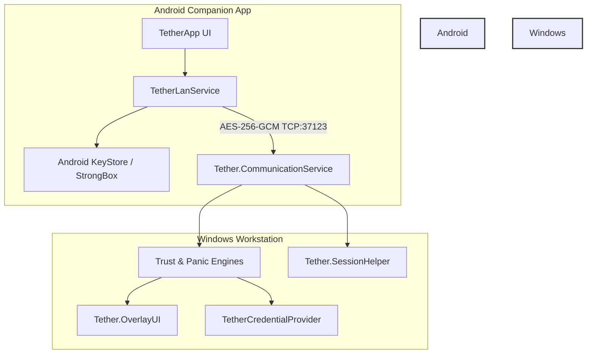

# Tether

> **Adaptive personal trust and security system for Windows and Android.**

**Platform:** Windows | Android &nbsp;•&nbsp; **Status:** Canary (Active Development) &nbsp;•&nbsp; **Transport:** Local Wi-Fi / LAN Only (AES-256-GCM)

---

> **⚠️ BETA / CANARY DEVELOPMENT STATUS**
>
> Tether is currently under active development on the `canary` branch. It should not be relied upon for mission-critical production security environments without independent review. See the [Security Model](#security-model) section for details.

---

## Table of Contents

- [Overview](#overview)
- [Key Features](#key-features)
- [Architecture & System Design](#architecture--system-design)
- [Supported Platforms](#supported-platforms)
- [Prerequisites](#prerequisites)
- [Installation & Build Instructions](#installation--build-instructions)
- [Quick Start & Usage](#quick-start--usage)
- [Security Model](#security-model)
- [Project Structure](#project-structure)
- [Configuration](#configuration)
- [Troubleshooting & FAQ](#troubleshooting--faq)
- [Roadmap](#roadmap)
- [Contributing](#contributing)
- [License](#license)
- [Acknowledgements](#acknowledgements)

---

## Overview

**Tether** is an open-source, high-security personal trust and authentication platform that bridges an Android device and a Windows workstation. It transforms your smartphone into a cryptographically secured **trust anchor**, enabling proximity-aware authentication, continuous trust validation, instant workstation locking, emergency panic lockdowns, and hardware-backed credential integration.

Unlike cloud-dependent companion apps, Tether operates **exclusively over local infrastructure Wi-Fi / LAN**, ensuring zero third-party telemetry, zero cloud relays, and zero exposure over public WANs.

### Who is Tether for?
- **Privacy Enthusiasts**: Users demanding zero cloud dependency and strict local network boundaries for desktop-mobile synchronization.
- **Security-Conscious Professionals**: Individuals seeking physical presence verification, hardware-backed key storage, and instant emergency lockdown capabilities.
- **Developers & Researchers**: Systems programmers exploring Windows Credential Providers, secure local IPC, and Android KeyStore cryptography.

---

## Key Features

### 🛡️ Android Trust Anchor & Pairing
- **Hardware-Backed Cryptography**: Utilizes Android KeyStore and StrongBox for RSA-2048 key generation and signing.
- **Secure QR / Local Discovery**: Zero-configuration discovery over local Wi-Fi via mDNS (`_tether._tcp.`) and UDP broadcast scanning.
- **Explicit Hotspot Rejection**: Automatically detects and blocks insecure Mobile Hotspot or tethering configurations to maintain strict L2/L3 infrastructure boundaries.

### ⚡ Panic Mode & Emergency Lockdown
- **Instant Workstation Isolation**: Instantly triggers workstation locking, session invalidation, and trust revocation from the mobile companion app.
- **Emergency Workflows**: Hardened command dispatch path designed to isolate the host machine during security incidents.

### 🔄 Continuous Trust Validation
- **Real-Time Connectivity Monitoring**: `ConnectivityManager` callbacks immediately detect Wi-Fi drops, SSID changes, or network switches.
- **Automatic Key Wiping**: Active sessions and encryption keys are instantly wiped upon network detachment, preventing stale token reuse.

### 🪟 Windows Integration
- **Custom Credential Provider**: Integrates directly into the Windows logon screen via `TetherCredentialProvider`.
- **Background Communication Service**: Robust Windows service (`Tether.CommunicationService`) running locally on port `37123`.
- **Interactive UI Feedback**: Native WPF overlay (`Tether.OverlayUI`) and desktop configuration utility (`Tether.DesktopUI`).

---

## Architecture & System Design

Tether consists of an Android companion application communicating securely with a modular C# Windows service suite and native C++ Windows components over a local encrypted TCP socket.



### ASCII Architecture Overview

```
Android Tether App (Kotlin / Compose)
│
│ Local Wi-Fi / LAN (AES-256-GCM Encrypted TCP Socket on Port 37123)
▼
Tether Windows Communication Service (Tether.CommunicationService)
├── Trust Engine (Tether.TrustEngine)
├── Panic Engine (Tether.PanicEngine)
├── Recovery Engine (Tether.RecoveryEngine)
├── Enforcement Engine (Tether.EnforcementEngine)
└── Session Helper (Tether.SessionHelper)
    ├── Windows Credential Provider (TetherCredentialProvider)
    └── Overlay UI (Tether.OverlayUI)

BLE                 → NOT USED FOR COMMAND TRANSPORT
Internet            → NOT REQUIRED
Cloud Relay         → NOT USED
Mobile Hotspot      → NOT SUPPORTED
```

---

## Supported Platforms

| Platform | Target Version | Architecture | Framework / Runtime |
| :--- | :--- | :--- | :--- |
| **Windows** | Windows 10 / 11 | x64 | .NET 8, C++ (Win32 APIs) |
| **Android** | Android 12 (API 31) – 14+ | ARM64 / x86_64 | Kotlin, Jetpack Compose, API 37 |

---

## Prerequisites

### Windows Development & Build Environment
- **Visual Studio 2022** with the following workloads:
  - *Desktop development with C++*
  - *.NET Desktop Development*
- **Windows SDK** (10.0.22621.0 or later)
- **.NET 8 SDK**
- **CMake** & **MSBuild**

### Android Development & Build Environment
- **Android Studio** (Latest stable)
- **JDK 17+**
- **Android SDK** (Compile SDK 37, Min SDK 27)
- Physical Android device (API 31+) connected over local Wi-Fi for testing.

---

## Installation & Build Instructions

### 1. Building the Windows Solution
The Windows component suite is organized around a solution file (`Tether.slnx`).

1. Clone the repository:
   ```bash
   git clone https://github.com/tirthsaraiya29/Tether.git
   cd Tether
   ```
2. Build the solution using the .NET CLI or Visual Studio 2022:
   ```bash
   dotnet build Tether.slnx
   ```
3. To register the Windows Credential Provider DLL (`TetherCredentialProvider`), run the registration script as Administrator:
   ```cmd
   cd TetherCredentialProvider
   regsvr32 TetherCredentialProvider.dll
   ```

### 2. Building the Android Companion App
1. Navigate to the Android companion directory:
   ```bash
   cd apps/android-companion
   ```
2. Build the debug APK using Gradle:
   ```bash
   ./gradlew assembleDebug
   ```
3. Install the APK onto your test device:
   ```bash
   ./gradlew installDebug
   ```

---

## Quick Start & Usage

1. **Start the Windows Service**: Ensure `Tether.CommunicationService` is running on your Windows workstation. It will automatically bind to port `37123` and advertise its presence via mDNS (`_tether._tcp.`).
2. **Launch Android App**: Open the Tether companion app on your phone while connected to the same local Wi-Fi network.
3. **Pair Devices**: Scan the pairing QR code displayed by the Windows Desktop UI (`Tether.DesktopUI`) or accept the discovered LAN endpoint.
4. **Authenticate & Lock**: Use the app to lock your workstation, monitor connection status, or trigger panic lockdown.

---

## Security Model

### 1. Network Boundary & Threat Isolation
- **LAN-Only Constraint**: Tether requires both devices to be clients on the same local Wi-Fi infrastructure. Public WAN routing, VPNs, and port forwarding are explicitly unsupported.
- **Hotspot Rejection**: The Android client validates network capabilities and rejects Mobile Hotspot / tethering modes to prevent man-in-the-middle or routing anomalies.

### 2. Cryptographic Handshake & Mutual Authentication
- **Asymmetric Handshake**: Device pairing exchanges RSA-2048 public keys and 32-byte cryptographic random nonces (`phoneNonce` and `windowsNonce`).
- **Hardware-Backed Keystore**: Private keys reside securely inside the Android KeyStore / StrongBox hardware modules.
- **Session Key Encapsulation**: The Windows host provisions an AES-256 session key encrypted with the phone's public key.

### 3. Encrypted Frame Transport
- **AES-256-GCM**: All command payloads (`lock_now`, `unlock`, `panic`, `sleep`, `reboot`, `shutdown`) are encrypted using AES-256-GCM with unique 12-byte initialization vectors (IVs).
- **Replay Protection**: Every packet includes a UUID `requestId`, timestamp, and nonce. Duplicate or stale request IDs are dropped instantly.

---

## Project Structure

```
Tether/
├── Tether.slnx                      # Windows solution file
├── Tether.OverlayUI/                # WPF overlay feedback UI
├── TetherCredentialProvider/        # Native C++ Windows Credential Provider
├── apps/
│   ├── android-companion/           # Android Kotlin / Compose companion app
│   └── desktop-ui/                  # Windows desktop configuration UI
├── services/
│   ├── communication-service/       # Core TCP socket listener & dispatcher
│   ├── enforcement-engine/          # Policy enforcement system
│   ├── event-bus/                   # IPC and inter-module event bus
│   ├── panic-engine/                # Emergency lockdown controller
│   ├── recovery-engine/             # Fallback and recovery mechanisms
│   └── trust-engine/                # Trust validation logic
├── shared/
│   └── Tether.Shared/               # Shared DTOs, crypto helpers, and constants
└── tests/
    └── PipeTest/                    # IPC pipe testing utilities
```

---

## Configuration

Windows service and desktop settings can be configured via `appsettings.json` located within the respective service directories.

- **Default Port**: `37123` (TCP)
- **mDNS Service Type**: `_tether._tcp.`

---

## Troubleshooting & FAQ

### Q: Why does the Android app show "Hotspot Unsupported"?
**A:** Tether Canary strictly requires both devices to be clients on an established Wi-Fi infrastructure network. Operating your phone as a mobile Wi-Fi hotspot or tethering access point is disabled for security reasons. Connect both devices to a standard Wi-Fi router/AP.

### Q: The Windows service cannot be discovered on the network.
**A:** Ensure that Windows Firewall allows inbound TCP traffic on port `37123` and that both your PC and phone reside on the exact same IP subnet / VLAN without client isolation enabled on your wireless router.

---

## Roadmap

- [ ] Support for hardware security keys (FIDO2 / WebAuthn integration)
- [ ] Expanded biometric confirmation flows on Android
- [ ] Multi-device management dashboard in `Tether.DesktopUI`
- [ ] Comprehensive automated integration test suite

---

## Contributing

Contributions are welcome! Please follow these guidelines:
1. Fork the repository and create your feature branch (`git checkout -b feature/amazing-feature`).
2. Ensure all changes adhere to the local transport architecture constraints (LAN-only, no cloud telemetry).
3. Commit your changes (`git commit -m 'Add amazing feature'`).
4. Push to the branch (`git origin push feature/amazing-feature`) and open a Pull Request.

---

## License

<!-- TODO: Specify project license -->
No license has been specified for this project yet. All rights reserved.

---

## Acknowledgements

- Built with [.NET 8](https://dotnet.microsoft.com/), [Jetpack Compose](https://developer.android.com/jetpack/compose), and [BouncyCastle](https://www.bouncycastle.org/).
- Inspired by modern zero-trust architecture principles and local-first software design.

<!-- TODO: add screenshot -->
