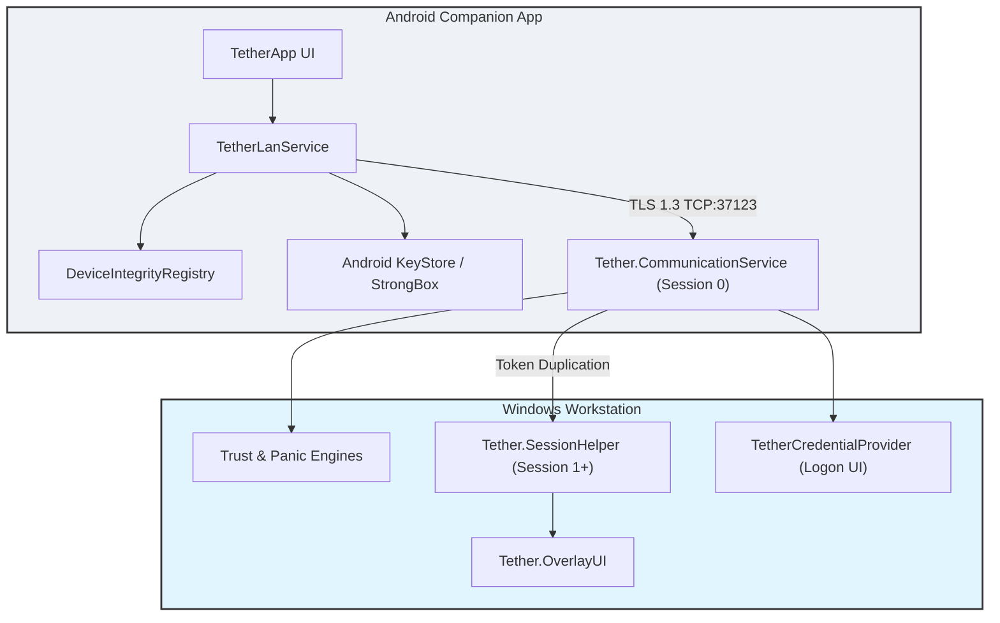

# Tether

> **Adaptive personal trust and security system for Windows and Android.**

**Platform:** Windows | Android &nbsp;•&nbsp; **Status:** Canary (Active Development) &nbsp;•&nbsp; **Transport:** Local Wi-Fi / LAN Only (TLS 1.3 Direct TCP)

---

> **⚠️ BETA / CANARY DEVELOPMENT STATUS**
>
> Tether is currently under active development on the `canary` branch. It should not be relied upon for mission-critical production security environments without independent review. See the [Security Model](#security-model) section for details.

---

## Table of Contents

- [Overview](#overview)
- [Use Cases & Value Proposition](#use-cases--value-proposition)
- [Key Features](#key-features)
- [Visual Highlights & UI Screenshots](#visual-highlights--ui-screenshots)
- [Architecture & System Design](#architecture--system-design)
- [Architecture Deep-Dive for Contributors](#architecture-deep-dive-for-contributors)
- [Supported Platforms](#supported-platforms)
- [Prerequisites](#prerequisites)
- [Installation & Build Instructions](#installation--build-instructions)
- [Quick Start & Usage](#quick-start--usage)
- [Security Model](#security-model)
- [Project Structure](#project-structure)
- [Configuration](#configuration)
- [Troubleshooting & Error Matrix](#troubleshooting--error-matrix)
- [Roadmap](#roadmap)
- [Contributing](#contributing)
- [License](#license)
- [Acknowledgements](#acknowledgements)

---

## Overview

**Tether** is an open-source, high-security personal trust and authentication platform that bridges an Android device and a Windows workstation. It transforms your smartphone into a cryptographically secured **trust anchor**, enabling proximity-aware authentication, continuous trust validation, instant workstation locking, emergency panic lockdowns, hardware-backed credential integration, and remote input control.

Unlike cloud-dependent companion apps, Tether operates **exclusively over local infrastructure Wi-Fi / LAN**, ensuring zero third-party telemetry, zero cloud relays, and zero exposure over public WANs.

### Who is Tether for?
- **Privacy Enthusiasts**: Users demanding zero cloud dependency and strict local network boundaries for desktop-mobile synchronization.
- **Security-Conscious Professionals**: Individuals seeking physical presence verification, hardware-backed key storage, and instant emergency lockdown capabilities.
- **Developers & Researchers**: Systems programmers exploring Windows Credential Providers, Session 0 isolation bypasses, secure local IPC, and Android KeyStore cryptography.

---

## Use Cases & Value Proposition

- **🔒 Walk-Away Auto-Lock**: Instantly lock your workstation when walking away or leaving your desk via phone notification or manual trigger.
- **👆 Biometric Windows Unlock**: Unlock your locked Windows PC securely using your phone's fingerprint sensor without typing passwords.
- **🚨 Emergency Panic Button**: Revoke trust, invalidate active sessions, and isolate your PC instantly in case of physical security risks.
- **🎛️ Deskless Remote Control**: Adjust PC volume, screen brightness, or launch Task Manager/Browser remotely during presentations or media playback.
- **🖱️ Remote Trackpad & Input**: Control cursor movement, multi-touch scroll gestures, and text input directly from your smartphone screen.

---

## Key Features

### 🛡️ Android Trust Anchor & Pairing
- **Hardware-Backed Cryptography**: Utilizes Android KeyStore and StrongBox for RSA-2048 key generation and signing (`TetherAsymmetricKey_v3`).
- **Secure QR / Local Discovery**: Zero-configuration discovery over local Wi-Fi via mDNS (`_tether._tcp.`) and UDP broadcast scanning on port `37123`.
- **Explicit Hotspot Rejection**: Automatically detects and blocks insecure Mobile Hotspot or tethering configurations to maintain strict L2/L3 infrastructure boundaries.
- **On-Device Integrity Attestation**: Evaluates root status, developer mode risks, and biometric availability prior to issuing privileged directives.

### ⚡ Panic Mode & Emergency Lockdown
- **Instant Workstation Isolation**: Instantly triggers workstation locking, session invalidation, and trust revocation from the mobile companion app.
- **Emergency Workflows**: Hardened command dispatch path designed to isolate the host machine during security incidents.

### 🔄 Continuous Trust Validation
- **Real-Time Connectivity Monitoring**: `ConnectivityManager` callbacks immediately detect Wi-Fi drops, SSID changes, or network switches.
- **Automatic Key Wiping**: Active sessions and encryption keys are instantly wiped upon network detachment, preventing stale token reuse.

### 🪟 Windows Integration & Session 0 Isolation Bypass
- **Custom Credential Provider**: Native C++ Win32 DLL (`TetherCredentialProvider`) integrated into the Windows logon screen.
- **Background Communication Service**: Robust Windows service (`Tether.CommunicationService`) running locally on port `37123`.
- **Session Helper Executable**: `Tether.SessionHelper.exe` launches in user sessions (Session 1+) via token duplication to access user audio endpoints, wallpaper paths, and display UI overlays.
- **Interactive UI Feedback**: Native WPF overlay (`Tether.OverlayUI`) and desktop configuration utility (`Tether.DesktopUI`).

---

## Visual Highlights & UI Screenshots

<!-- TODO: Android Companion App Main Screen Screenshot -->
*Android Companion App Main Dashboard & Trust Indicator*

<!-- TODO: Remote Trackpad UI Screenshot -->
*Remote Touch Trackpad & Gesture Screen*

<!-- TODO: Windows Desktop Configuration UI Screenshot -->
*Windows Desktop Configuration & Device Management UI*

<!-- TODO: Windows Overlay UI Lock/Unlock Animation Screenshot -->
*Windows WPF Overlay Screen Notification*

---

## Architecture & System Design

Tether consists of an Android companion application communicating securely with a modular C# Windows service suite and native C++ Windows components over a local TLS 1.3 TCP socket.



### ASCII Architecture Overview

```
Android Tether App (Kotlin / Compose)
│
│ Local Wi-Fi / LAN (TLS 1.3 Direct TCP Socket on Port 37123)
▼
Tether Windows Communication Service (Tether.CommunicationService - Session 0)
├── Trust Engine (Tether.TrustEngine)
├── Panic Engine (Tether.PanicEngine)
├── Recovery Engine (Tether.RecoveryEngine)
├── Enforcement Engine (Tether.EnforcementEngine)
└── Session Helper (Tether.SessionHelper - Session 1+)
    ├── Audio & Brightness Controller
    ├── Lock State Detector
    ├── TetherCredentialProvider (Win32 Logon UI)
    └── Overlay UI (Tether.OverlayUI)

BLE                 → NOT USED FOR COMMAND TRANSPORT
Internet            → NOT REQUIRED
Cloud Relay         → NOT USED
Mobile Hotspot      → NOT SUPPORTED
```

---

## Architecture Deep-Dive for Contributors

### Windows Session 0 Isolation & Session Helper
Windows services run in **Session 0**, which is completely isolated from interactive desktop user sessions (Session 1+). To interact with logged-in user desktop state, `Tether.CommunicationService`:
1. Queries the active console session via `WTSGetActiveConsoleSessionId()`.
2. Obtains and duplicates the primary user token via `WTSQueryUserToken` and `DuplicateTokenEx`.
3. Spawns `Tether.SessionHelper.exe` in the user's interactive session context via `CreateProcessAsUser`.

### Named Pipe IPC Mapping
Communication across Windows processes uses named pipes configured with strict ACLs:
- **`TetherPipe`**: Service ↔ Desktop UI event bus (`Tether.Shared.IPC.IpcConstants.PipeName`).
- **`TetherUiPipe`**: Service ↔ Overlay UI display relay (`IpcConstants.UiPipeName`).
- **`Tether.InputPipe`**: Communication Service ↔ Session Helper stream for remote touch & keyboard events.

### Developer Test Suite Commands
- **Android Unit Tests**:
  ```bash
  cd apps/android-companion
  ./gradlew test
  ```
- **Windows Solution Build**:
  ```bash
  dotnet build Tether.slnx
  ```
- **IPC Pipe Test Utility**:
  ```bash
  dotnet run --project tests/PipeTest/PipeTest.csproj
  ```

---

## Supported Platforms

| Platform | Target Version | Architecture | Framework / Runtime |
| :--- | :--- | :--- | :--- |
| **Windows** | Windows 10 / 11 | x64 | .NET 8, C++ (Win32 APIs) |
| **Android** | Android 12 (API 31) – 14+ | ARM64 / x86_64 | Kotlin, Jetpack Compose, API 37 |

---

## Prerequisites

### Windows Development & Build Environment
- **Visual Studio 2022** with the following workloads:
  - *Desktop development with C++*
  - *.NET Desktop Development*
- **Windows SDK** (10.0.22621.0 or later)
- **.NET 8 SDK**
- **CMake** & **MSBuild**

### Android Development & Build Environment
- **Android Studio** (Latest stable)
- **JDK 17+**
- **Android SDK** (Compile SDK 37, Min SDK 27)
- Physical Android device (API 31+) connected over local Wi-Fi for testing.

---

## Installation & Build Instructions

### 1. Building the Windows Solution
The Windows component suite is organized around a solution file (`Tether.slnx`).

1. Clone the repository:
   ```bash
   git clone https://github.com/tirthsaraiya29/Tether.git
   cd Tether
   ```
2. Build the solution using the .NET CLI or Visual Studio 2022:
   ```bash
   dotnet build Tether.slnx
   ```
3. To register the Windows Credential Provider DLL (`TetherCredentialProvider`), run the registration script as Administrator:
   ```cmd
   cd TetherCredentialProvider
   regsvr32 TetherCredentialProvider.dll
   ```

### 2. Building the Android Companion App
1. Navigate to the Android companion directory:
   ```bash
   cd apps/android-companion
   ```
2. Build the debug APK using Gradle:
   ```bash
   ./gradlew assembleDebug
   ```
3. Install the APK onto your test device:
   ```bash
   ./gradlew installDebug
   ```

---

## Quick Start & Usage

1. **Start the Windows Service**: Ensure `Tether.CommunicationService` is running on your Windows workstation. It will automatically bind to port `37123` and advertise its presence via mDNS (`_tether._tcp.`).
2. **Launch Android App**: Open the Tether companion app on your phone while connected to the same local Wi-Fi network.
3. **Pair Devices**: Scan the pairing QR code displayed by the Windows Desktop UI (`Tether.DesktopUI`) or accept the discovered LAN endpoint.
4. **Authenticate & Control**: Use the app to lock/unlock your workstation, control volume/brightness, use the touch trackpad, monitor connection status, or trigger panic lockdown.

---

## Security Model

### 1. TLS 1.3 Mutual Authentication & Cryptographic Handshake
- **TLS 1.3 Socket**: All command and state traffic travels over a direct TLS 1.3 encrypted TCP connection on port `37123`.
- **RSA-2048 Key Pair**: Device pairing exchanges RSA-2048 public keys and 32-byte cryptographic random nonces (`phoneNonce` and `windowsNonce`).
- **Hardware-Backed KeyStore**: Private keys reside securely inside Android KeyStore / StrongBox hardware modules (`TetherAsymmetricKey_v3`).

### 2. Local Infrastructure Boundary & Threat Isolation
- **Strict LAN Constraint**: Tether requires both devices to be clients on the same local Wi-Fi infrastructure network. Public WAN routing, VPNs, and port forwarding are explicitly unsupported.
- **Mobile Hotspot Rejection**: The Android client validates network capabilities (`ConnectivityManager`) and rejects Mobile Hotspot / tethering modes (`HOTSPOT_UNSUPPORTED`) to prevent routing anomalies or man-in-the-middle risks.

### 3. Replay Protection & Session Hardening
- **UUID & Nonce Validation**: Every command payload includes a unique `requestId`, timestamp, and nonce. Replayed packets are dropped instantly.
- **Instant Key Wiping**: Active session keys are immediately wiped from memory upon Wi-Fi detachment or network state change.

### 4. On-Device Integrity Attestation
- **Environment Verification**: `DeviceIntegrityRegistry` runs checks for root detection, developer options risk factors, and biometric hardware presence before authorizing unlock operations.

---

## Project Structure

```
Tether/
├── Tether.slnx                      # Windows solution file
├── Tether.OverlayUI/                # WPF overlay feedback UI
├── TetherCredentialProvider/        # Native C++ Windows Credential Provider
├── apps/
│   ├── android-companion/           # Android Kotlin / Compose companion app
│   └── desktop-ui/                  # Windows desktop configuration UI
├── services/
│   ├── communication-service/       # Core TCP socket listener & dispatcher
│   │   ├── Tether.CommunicationService/ # Session 0 background service
│   │   └── Tether.SessionHelper/        # Session 1+ user desktop bridge
│   ├── enforcement-engine/          # Policy enforcement system
│   ├── event-bus/                   # IPC and inter-module event bus
│   ├── panic-engine/                # Emergency lockdown controller
│   ├── recovery-engine/             # Fallback and recovery mechanisms
│   └── trust-engine/                # Trust validation logic
├── shared/
│   └── Tether.Shared/               # Shared DTOs, IPC constants, and logging
└── tests/
    └── PipeTest/                    # IPC pipe testing utilities
```

---

## Configuration

Windows service and desktop settings can be configured via `appsettings.json` located within the respective service directories.

- **Default Port**: `37123` (TCP)
- **mDNS Service Type**: `_tether._tcp.`

---

## Troubleshooting & Error Matrix

| Error / Symptom | Cause | Resolution |
| :--- | :--- | :--- |
| **`HOTSPOT_UNSUPPORTED`** | Phone is operating in Mobile Hotspot AP mode. | Connect both phone and PC as clients on the same Wi-Fi router. |
| **`DISCOVERY_FAILED`** | mDNS or UDP broadcast blocked by Windows Firewall. | Allow inbound TCP/UDP on port `37123` via Windows Firewall rules. |
| **`HELPER_NOT_FOUND`** | `Tether.SessionHelper.exe` missing from bin directory. | Ensure full build of `Tether.slnx` so helper is placed alongside `CommunicationService`. |
| **`BIOMETRIC_FAILED`** | Biometric hardware unavailable or unverified. | Set up fingerprint/PIN lock on Android device. |

---

## Roadmap

- [ ] Support for hardware security keys (FIDO2 / WebAuthn integration)
- [ ] Expanded biometric confirmation flows on Android
- [ ] Multi-device management dashboard in `Tether.DesktopUI`
- [ ] Comprehensive automated integration test suite

---

## Contributing

Contributions are welcome! Please follow these guidelines:
1. Fork the repository and create your feature branch (`git checkout -b feature/amazing-feature`).
2. Ensure all changes adhere to the local transport architecture constraints (LAN-only, no cloud telemetry).
3. Commit your changes (`git commit -m 'Add amazing feature'`).
4. Push to the branch (`git origin push feature/amazing-feature`) and open a Pull Request.

---

## License

<!-- TODO: Specify project license -->
No license has been specified for this project yet. All rights reserved.

---

## Acknowledgements

- Built with [.NET 8](https://dotnet.microsoft.com/), [Jetpack Compose](https://developer.android.com/jetpack/compose), and [BouncyCastle](https://www.bouncycastle.org/).
- Inspired by modern zero-trust architecture principles and local-first software design.
