# Tether

**Adaptive personal trust and security system for Windows and Android.**

- **Platforms:** Windows and Android
- **Status:** Active Development
- **Transport:** Local Wi-Fi/LAN — TLS 1.3 over direct TCP

> [!WARNING]
> **BETA DEVELOPMENT STATUS**
>
> Tether is under active development. Do not rely on it for mission-critical production security without an independent security review. Review the [Security Model](#security-model) and the release notes before use.

## Table of Contents

- [Overview](#overview)
- [Installation and Setup](#installation-and-setup)
- [Use Cases and Value Proposition](#use-cases-and-value-proposition)
- [Key Features](#key-features)
- [Visual Highlights and UI Screenshots](#visual-highlights-and-ui-screenshots)
- [Architecture and System Design](#architecture-and-system-design)
- [Architecture Deep Dive for Contributors](#architecture-deep-dive-for-contributors)
- [Supported Platforms](#supported-platforms)
- [Prerequisites](#prerequisites)
- [Quick Start and Usage](#quick-start-and-usage)
- [Security Model](#security-model)
- [Project Structure](#project-structure)
- [Configuration](#configuration)
- [Troubleshooting and Error Matrix](#troubleshooting-and-error-matrix)
- [Roadmap](#roadmap)
- [Contributing](#contributing)
- [License](#license)
- [Acknowledgements](#acknowledgements)

---

## Overview

**Tether** is an open-source personal trust and authentication platform designed to connect an Android device with a Windows workstation. It aims to use a smartphone as a cryptographically secured **trust anchor**, enabling device-based authentication workflows, workstation locking, trust validation, emergency lockdown, and remote workstation control.

Unlike cloud-dependent companion applications, Tether communicates directly over local Wi-Fi/LAN infrastructure without requiring a cloud relay.

## Installation and Setup

Download prebuilt binaries directly from the official releases:

[**Download Tether from GitHub Releases**](https://github.com/tirthsaraiya29/Tether/releases)

### 1. Download Artifacts

- Windows Installer: `Tether-Setup-*.exe`
- Android Companion: `Tether-*.apk`

### 2. Windows Account Preparation

> [!WARNING]
> Do not disable your default sign-in methods or remove PIN/password options. Maintain a secondary administrator account during beta testing.

### 3. Install on Windows

1. Run `Tether-Setup-*.exe` as Administrator.
2. Complete the wizard to install `Tether.CommunicationService`, register `TetherCredentialProvider.dll`, and open local firewall port `37123`.
3. Launch `Tether Desktop UI`.

### 4. Install on Android

1. Transfer and install `Tether-*.apk` on your mobile device.
2. Open Tether and grant the requested local network permissions.

### 5. Pair Devices

1. Connect both devices to the same local Wi-Fi network.
2. Open Tether Desktop UI and the Android companion app.
3. Initiate pairing from Android and enter the pairing code displayed on the desktop UI.
4. Verify the generated cryptographic fingerprint.

---

### Who Is Tether For?

- **Privacy Enthusiasts:** Users who prefer local-first communication and minimal dependence on cloud infrastructure.
- **Security-Conscious Users:** Users interested in device-based authentication, cryptographic identity, and workstation security.
- **Developers and Security Researchers:** People exploring Windows Credential Providers, secure inter-process communication (IPC), Android Keystore cryptography, and cross-platform authentication.

> [!IMPORTANT]
> Tether is an early-stage project. Its authentication workflows, security properties, and failure-recovery behavior should be independently verified before it is used to protect sensitive systems.

## Use Cases and Value Proposition

- **Device-Assisted Windows Unlock:** Use an Android device as part of a supported Windows authentication workflow.
- **Emergency Workstation Locking:** Request an immediate workstation lock from the mobile companion application.
- **Trust Revocation:** Initiate trust-related state invalidation through supported security workflows.
- **Remote Desktop Controls:** Adjust supported PC settings, including audio volume, and invoke supported desktop actions.
- **Remote Trackpad and Input:** Control cursor movement, scrolling, clicks, and supported keyboard input from Android.
- **Local-First Connectivity:** Communicate directly over a supported local network without requiring a cloud relay.

## Key Features

### Android Trust Anchor and Pairing

- **Android Keystore Integration:** Uses Android Keystore for cryptographic key management, with hardware-backed storage or StrongBox where supported and configured.
- **RSA-2048 Key Material:** Uses the `TetherAsymmetricKey_v3` alias for key generation and signing.
- **Local Device Discovery:** Supports mDNS discovery using `_tether._tcp.` and UDP broadcast discovery on port `37123`.
- **Device Integrity Checks:** Evaluates selected security signals, including root status, developer settings, and biometric availability.
- **Persistent Device Identity:** Binds paired devices to cryptographic identities for subsequent connections.

### Panic Mode and Emergency Lockdown

- **Workstation Locking:** Requests immediate workstation locking through the configured command path.
- **Trust Revocation:** Invalidates active trust relationships and associated session state.
- **Emergency Command Dispatch:** Dedicated workflow for high-priority security events.

### Continuous Trust Validation

- **Connectivity Monitoring:** Uses Android connectivity callbacks to detect Wi-Fi disconnections and network changes.
- **Session Cleanup:** Invalidates active session state when connectivity drops or switches interfaces.
- **Stale Request Protection:** Uses monotonic request identifiers, timestamps, and nonces for replay prevention.

### Windows Integration

- **Custom Credential Provider:** Native C++ Win32 Credential Provider integration through `TetherCredentialProvider`.
- **Communication Service:** `Tether.CommunicationService` handles local network communication, packet routing, and command dispatch.
- **Interactive Session Helper:** `Tether.SessionHelper.exe` operates inside active user sessions for session-bound operations.
- **Desktop Configuration UI:** `Tether.DesktopUI` provides an interface for status monitoring, configuration, and diagnostics.
- **Named-Pipe IPC:** Windows services and desktop clients communicate through authenticated inter-process communication channels.
- **Service Lifecycle Management:** Direct service restart control from `Tether.DesktopUI` using the Windows Service Control Manager (SCM) APIs.

### Remote Control and Execution

- **Audio Control:** Adjust system audio levels directly from Android.
- **Display Brightness:** Adjust monitor brightness via the interactive session helper.
- **Remote Input:** Stream mouse movement, clicks, scrolling, and modifier-key events.
- **Application Launching:** Launch configured Windows utilities into the active desktop session.

---

## Visual Highlights and UI Screenshots

**Screenshot directory:** `docs/assets/screenshots/`

### Workstation Control Plane

The Windows desktop interface provides IPC diagnostics, system audio and display-brightness controls, and DPAPI-backed local vault integration.

<p align="center">
  
</p>

<p align="center">
  <em><strong>Desktop Telemetry Control Plane</strong> — IPC diagnostic event stream, Core Audio and display-brightness integrations, and DPAPI-backed local vault subsystem.</em>
</p>

### Mobile Command and Input Experience

<table>
  <tr>
    <td width="50%" align="center" valign="top">
      
      <br /><br />
      <strong>Mobile Trust Command Center</strong>
      <p>Workstation connection status, lock and unlock controls, emergency lockdown, audio controls, and brightness sliders.</p>
    </td>
    <td width="50%" align="center" valign="top">
      
      <br /><br />
      <strong>Remote Trackpad</strong>
      <p>Cursor movement, scrolling, and supported Windows modifier-key input.</p>
    </td>
  </tr>
</table>

### Remote Execution and Handshake Security

<table>
  <tr>
    <td width="50%" align="center" valign="top">
      
      <br /><br />
      <strong>System Application Launcher</strong>
      <p>Session-aware requests to launch supported utilities, including Terminal, Task Manager, File Explorer, and Windows Settings.</p>
    </td>
    <td width="50%" align="center" valign="top">
      
      <br /><br />
      <strong>Handshake Verification</strong>
      <p>Connection verification and authorization-state checks before sensitive command dispatch.</p>
    </td>
  </tr>
</table>

### Identity Pinning and Device Integrity

<table>
  <tr>
    <td width="50%" align="center" valign="top">
      
      <br /><br />
      <strong>Cryptographic Device Pairing</strong>
      <p>Public-key fingerprint verification and persistent identity binding between Android and Windows.</p>
    </td>
    <td width="50%" align="center" valign="top">
      
      <br /><br />
      <strong>Device Integrity and Policy Configuration</strong>
      <p>Device-security signals, runtime policies, and socket-daemon controls.</p>
    </td>
  </tr>
</table>

### Local Network Connectivity

<p align="center">
  
</p>

<p align="center">
  <em><strong>Local Network Boundary</strong> — Designed for direct communication between paired devices on a supported local Wi-Fi/LAN network.</em>
</p>

---

## Architecture and System Design

Tether connects an Android companion application to a Windows workstation through a modular, local-network communication architecture.

### Component Interaction Diagram

```mermaid
flowchart TD

subgraph group_android["Android Companion"]
  node_mobile_ui["Mobile controls<br/>[MainScreens.kt]"]
  node_remote_input_ui["Remote trackpad<br/>[RemoteInputScreen.kt]"]
  node_android_service["LAN companion service<br/>[TetherLanService.kt]"]
  node_security["Device cryptography<br/>[ProductionSecurityEngine.kt]"]
end

subgraph group_desktop["Windows Desktop"]
  node_desktop["Desktop configuration<br/>[MainWindow.xaml.cs]"]
end

subgraph group_connectivity["Pairing and Connectivity"]
  node_discovery["Device discovery<br/>[TetherDiscoveryManager.kt]"]
  node_pairing["Pairing manager<br/>[TetherPairingManager.kt]"]
end

subgraph group_windows["Windows Communication Service"]
  node_tcp_server["TLS TCP server<br/>[TetherTcpServer.cs]"]
  node_session["Secure session<br/>[TetherSession.cs]"]
  node_session_manager["Session registry<br/>[SessionManager.cs]"]
  node_router["Packet router<br/>[PacketRouter.cs]"]
  node_pairing_service["Windows pairing<br/>[PairingManager.cs]"]
  node_devices[("Device registry<br/>[DeviceManager.cs]")]
end

subgraph group_control["Workstation Control & Execution"]
  node_capabilities["Capability checks<br/>[CapabilityManager.cs]"]
  node_hardware["Hardware commands<br/>[HardwareExecutor.cs]"]
  node_state["Laptop state<br/>[LaptopStateCollector.cs]"]
  node_helper["Interactive session helper<br/>[Program.cs]"]
end

subgraph group_trust["Trust & Response Engine"]
  node_trust_store[("Trusted-device store<br/>[TrustStore.cs]")]
  node_event_bus["Event bus<br/>[InMemoryEventBus.cs]"]
  node_events["Trust events<br/>[TetherEvent.cs]"]
  node_trust_manager["Trust state<br/>[TrustStateManager.cs]"]
  node_panic["Panic workflow<br/>[PanicManager.cs]"]
  node_enforcement["Lock enforcement<br/>[EnforcementManager.cs]"]
end

node_user(("User"))
node_lan(("Local Network"))

node_user -->|"controls"| node_mobile_ui
node_user -->|"controls"| node_remote_input_ui
node_user -->|"configures workstation"| node_desktop
node_mobile_ui -.->|"sends commands"| node_android_service
node_remote_input_ui -->|"sends input"| node_android_service
node_android_service -->|"starts discovery"| node_discovery
node_android_service -->|"delegates pairing"| node_pairing
node_pairing -->|"uses keys"| node_security
node_discovery -->|"discovers over"| node_lan
node_android_service -->|"sends TLS frames"| node_lan
node_lan -->|"delivers frames"| node_tcp_server
node_tcp_server -.->|"accepts connections"| node_session
node_session -->|"requests pairing"| node_pairing_service
node_pairing_service -->|"promotes paired device"| node_devices
node_devices -->|"persists devices"| node_trust_store
node_session -->|"routes frames"| node_router
node_session_manager -->|"updates connection state"| node_devices
node_router -->|"checks permissions"| node_capabilities
node_router -->|"executes commands"| node_hardware
node_router -->|"collects state"| node_state
node_hardware -.->|"dispatches session actions"| node_helper
node_session -.->|"returns state and frames"| node_android_service
node_session -->|"publishes trust changes"| node_event_bus
node_router -->|"publishes degradation"| node_event_bus
node_event_bus -->|"transfers events"| node_events
node_trust_manager -->|"subscribes and publishes"| node_event_bus
node_panic -->|"publishes panic"| node_event_bus
node_enforcement -->|"subscribes to events"| node_event_bus

click node_mobile_ui "https://github.com/tirthsaraiya29/tether/blob/main/apps/android-companion/app/src/main/java/com/tether/phone/ui/screens/MainScreens.kt"
click node_remote_input_ui "https://github.com/tirthsaraiya29/tether/blob/main/apps/android-companion/app/src/main/java/com/tether/phone/ui/screens/RemoteInputScreen.kt"
click node_android_service "https://github.com/tirthsaraiya29/tether/blob/main/apps/android-companion/app/src/main/java/com/tether/phone/TetherLanService.kt"
click node_security "https://github.com/tirthsaraiya29/tether/blob/main/apps/android-companion/app/src/main/java/com/tether/phone/ProductionSecurityEngine.kt"
click node_discovery "https://github.com/tirthsaraiya29/tether/blob/main/apps/android-companion/app/src/main/java/com/tether/phone/TetherDiscoveryManager.kt"
click node_pairing "https://github.com/tirthsaraiya29/tether/blob/main/apps/android-companion/app/src/main/java/com/tether/phone/TetherPairingManager.kt"
click node_tcp_server "https://github.com/tirthsaraiya29/tether/blob/main/services/communication-service/Tether.CommunicationService/Transport/TetherTcpServer.cs"
click node_session "https://github.com/tirthsaraiya29/tether/blob/main/services/communication-service/Tether.CommunicationService/Transport/TetherSession.cs"
click node_session_manager "https://github.com/tirthsaraiya29/tether/blob/main/services/communication-service/Tether.CommunicationService/Sessions/SessionManager.cs"
click node_router "https://github.com/tirthsaraiya29/tether/blob/main/services/communication-service/Tether.CommunicationService/Protocol/PacketRouter.cs"
click node_pairing_service "https://github.com/tirthsaraiya29/tether/blob/main/services/communication-service/Tether.CommunicationService/Pairing/PairingManager.cs"
click node_devices "https://github.com/tirthsaraiya29/tether/blob/main/services/communication-service/Tether.CommunicationService/Devices/DeviceManager.cs"
click node_trust_store "https://github.com/tirthsaraiya29/tether/blob/main/services/communication-service/Tether.CommunicationService/Trust/TrustStore.cs"
click node_capabilities "https://github.com/tirthsaraiya29/tether/blob/main/services/communication-service/Tether.CommunicationService/Capabilities/CapabilityManager.cs"
click node_hardware "https://github.com/tirthsaraiya29/tether/blob/main/services/communication-service/Tether.CommunicationService/Capabilities/HardwareExecutor.cs"
click node_state "https://github.com/tirthsaraiya29/tether/blob/main/services/communication-service/Tether.CommunicationService/Capabilities/LaptopStateCollector.cs"
click node_helper "https://github.com/tirthsaraiya29/tether/blob/main/services/communication-service/Tether.SessionHelper/Program.cs"
click node_event_bus "https://github.com/tirthsaraiya29/tether/blob/main/services/event-bus/Tether.EventBus/InMemoryEventBus.cs"
click node_events "https://github.com/tirthsaraiya29/tether/blob/main/shared/Tether.Shared/Events/TetherEvent.cs"
click node_trust_manager "https://github.com/tirthsaraiya29/tether/blob/main/services/trust-engine/Tether.TrustEngine/TrustStateManager.cs"
click node_panic "https://github.com/tirthsaraiya29/tether/blob/main/services/panic-engine/Tether.PanicEngine/PanicManager.cs"
click node_enforcement "https://github.com/tirthsaraiya29/tether/blob/main/services/enforcement-engine/Tether.EnforcementEngine/EnforcementManager.cs"
click node_desktop "https://github.com/tirthsaraiya29/tether/blob/main/apps/desktop-ui/Tether.DesktopUI/MainWindow.xaml.cs"

classDef toneNeutral fill:#f8fafc,stroke:#334155,stroke-width:1.5px,color:#0f172a
classDef toneBlue fill:#dbeafe,stroke:#2563eb,stroke-width:1.5px,color:#172554
classDef toneAmber fill:#fef3c7,stroke:#d97706,stroke-width:1.5px,color:#78350f
classDef toneMint fill:#dcfce7,stroke:#16a34a,stroke-width:1.5px,color:#14532d
classDef toneRose fill:#ffe4e6,stroke:#e11d48,stroke-width:1.5px,color:#881337
classDef toneIndigo fill:#e0e7ff,stroke:#4f46e5,stroke-width:1.5px,color:#312e81
classDef toneTeal fill:#ccfbf1,stroke:#0f766e,stroke-width:1.5px,color:#134e4a

class node_mobile_ui,node_remote_input_ui,node_android_service,node_security,node_desktop,node_user toneBlue
class node_discovery,node_pairing toneAmber
class node_tcp_server,node_session,node_session_manager,node_router,node_pairing_service,node_devices toneMint
class node_capabilities,node_hardware,node_state,node_helper toneRose
class node_trust_store,node_event_bus,node_events,node_trust_manager,node_panic,node_enforcement,node_lan toneIndigo
```



> **Interactive Visualization:** You can also explore this architecture directly on [GitDiagram](https://gitdiagram.com/tirthsaraiya29/tether).

### Network Design Principles

- **Transport:** TLS 1.3 over direct TCP.
- **Default Communication Port:** `37123`.
- **Discovery:** mDNS and UDP broadcast.
- **Cloud Relay:** None.
- **BLE:** Not used as the primary command transport.
- **Mobile Hotspot:** Unsupported.

### Architectural Source References

| Component | Source File |
|---|---|
| Android mobile controls | [`MainScreens.kt`](apps/android-companion/app/src/main/java/com/tether/phone/ui/screens/MainScreens.kt) |
| Android remote input | [`RemoteInputScreen.kt`](apps/android-companion/app/src/main/java/com/tether/phone/ui/screens/RemoteInputScreen.kt) |
| Android LAN service | [`TetherLanService.kt`](apps/android-companion/app/src/main/java/com/tether/phone/TetherLanService.kt) |
| Android security engine | [`ProductionSecurityEngine.kt`](apps/android-companion/app/src/main/java/com/tether/phone/ProductionSecurityEngine.kt) |
| Android discovery | [`TetherDiscoveryManager.kt`](apps/android-companion/app/src/main/java/com/tether/phone/TetherDiscoveryManager.kt) |
| Android pairing | [`TetherPairingManager.kt`](apps/android-companion/app/src/main/java/com/tether/phone/TetherPairingManager.kt) |
| TCP server | [`TetherTcpServer.cs`](services/communication-service/Tether.CommunicationService/Transport/TetherTcpServer.cs) |
| Secure session | [`TetherSession.cs`](services/communication-service/Tether.CommunicationService/Transport/TetherSession.cs) |
| Session manager | [`SessionManager.cs`](services/communication-service/Tether.CommunicationService/Sessions/SessionManager.cs) |
| Packet router | [`PacketRouter.cs`](services/communication-service/Tether.CommunicationService/Protocol/PacketRouter.cs) |
| Windows pairing | [`PairingManager.cs`](services/communication-service/Tether.CommunicationService/Pairing/PairingManager.cs) |
| Device manager | [`DeviceManager.cs`](services/communication-service/Tether.CommunicationService/Devices/DeviceManager.cs) |
| Trusted-device store | [`TrustStore.cs`](services/communication-service/Tether.CommunicationService/Trust/TrustStore.cs) |
| Capability manager | [`CapabilityManager.cs`](services/communication-service/Tether.CommunicationService/Capabilities/CapabilityManager.cs) |
| Hardware executor | [`HardwareExecutor.cs`](services/communication-service/Tether.CommunicationService/Capabilities/HardwareExecutor.cs) |
| Laptop state collector | [`LaptopStateCollector.cs`](services/communication-service/Tether.CommunicationService/Capabilities/LaptopStateCollector.cs) |
| Session helper | [`Program.cs`](services/communication-service/Tether.SessionHelper/Program.cs) |
| Event bus | [`InMemoryEventBus.cs`](services/event-bus/Tether.EventBus/InMemoryEventBus.cs) |
| Shared trust events | [`TetherEvent.cs`](shared/Tether.Shared/Events/TetherEvent.cs) |
| Trust-state manager | [`TrustStateManager.cs`](services/trust-engine/Tether.TrustEngine/TrustStateManager.cs) |
| Panic manager | [`PanicManager.cs`](services/panic-engine/Tether.PanicEngine/PanicManager.cs) |
| Enforcement manager | [`EnforcementManager.cs`](services/enforcement-engine/Tether.EnforcementEngine/EnforcementManager.cs) |
| Desktop configuration UI | [`MainWindow.xaml.cs`](apps/desktop-ui/Tether.DesktopUI/MainWindow.xaml.cs) |

---

## Architecture Deep Dive for Contributors

### Windows Session 0 Isolation and Session Helper

Windows services run in Session 0, which is isolated from interactive desktop user sessions.

To interact with resources in an active user session:

1. Query the active console session with `WTSGetActiveConsoleSessionId()`.
2. Obtain an appropriate user token through `WTSQueryUserToken()`.
3. Duplicate the token using `DuplicateTokenEx()`.
4. Launch `Tether.SessionHelper.exe` in the target interactive session using `CreateProcessAsUser()`.

### Named-Pipe IPC Mapping

Windows components use named pipes for local inter-process communication:

- **`TetherPipe`:** Service-to-desktop-UI control and event channel (`Tether.Shared.IPC.IpcConstants.PipeName`).
- **`TetherUiPipe`:** Service-to-desktop-UI diagnostics relay (`IpcConstants.UiPipeName`), operating in byte transmission mode.
- **`Tether.InputPipe`:** Communication-service-to-session-helper stream for remote input events.

Named pipes must be hardened with strict ACLs, process identity validation, and message length validation to prevent unauthorized local manipulation.

---

## Supported Platforms

| Platform | Target Version | Architecture | Technology |
|---|---|---|---|
| Windows | Windows 10 / 11 | x64 | .NET 10, C++, Win32 APIs |
| Android | Android 12 (API 31) and later | ARM64 / x86_64 | Kotlin, Jetpack Compose |

---

## Prerequisites

- Windows 10 or Windows 11 x64 workstation.
- Android device running Android 12+.
- Shared local Wi-Fi/LAN connection on both devices.
- Administrative privileges on Windows for initial service/credential provider registration.
- An active, verified backup login method on Windows (PIN, Password, or Windows Hello).

---


## Quick Start and Usage

### Common Workflows

| Action | Mobile Workflow | Expected Result |
|---|---|---|
| **Unlock PC** | Tap Unlock and pass biometric challenge. | Sends authenticated unlock payload to `TetherCredentialProvider`. |
| **Lock PC** | Tap `LOCK`. | Calls workstation lock in active user session. |
| **Panic** | Tap `PANIC`. | Invalidates trust session and locks workstation immediately. |
| **Trackpad** | Swipe/tap trackpad screen. | Injects synthetic mouse events via Session Helper. |
| **Launch App** | Tap desired application shortcut. | Spawns utility process inside active user session. |
| **Audio Control** | Adjust volume slider. | Updates Windows Core Audio endpoint master volume. |
| **Brightness Control** | Adjust brightness slider. | Updates monitor brightness level via WMI methods. |

---

## Security Model

### 1. TLS 1.3 & Cryptographic Handshake
All control traffic is encapsulated within TLS 1.3 over direct TCP (`37123`). Mutual identity validation relies on stored RSA-2048 public keys paired with device-unique nonces (`phoneNonce`, `windowsNonce`).

### 2. Hardware Keystore Binding
Android private keys are generated inside the Android Keystore with StrongBox hardware protection enabled where supported by hardware. Keys never leave secure enclave boundaries.

### 3. Replay Protection & Freshness
All command payloads require:
- Monotonically increasing `requestId`.
- UTC timestamp validated against a strict drift window.
- Ephemeral cryptographic challenge nonces.

### 4. Device Integrity Signals
`DeviceIntegrityRegistry` verifies:
- Uncompromised root/SU status.
- Hardware-backed biometric availability.
- Developer options status.

### 5. Windows Credential Storage & Password Verification
- **Hashing Schemes:** Supports `pbkdf2-sha256-600k` (600,000 iterations), `pbkdf2-sha512-210k` (210,000 iterations), and legacy `sha256-v1` hashes with automatic inline upgrade upon successful authentication.
- **Side-Channel Mitigation:** Constant-time password verification prevents timing side-channel leakage during hash comparisons.
- **Registry Vault Hardening:** Credential secrets reside in a dedicated `HKLM\...\Secrets` registry subkey protected by hardened discretionary access control lists (`VaultDaclVersion=2`) restricted to privileged system accounts.

---

## Project Structure

```text
Tether/
├── Tether.slnx
├── TetherCredentialProvider/       # Native C++ Win32 Credential Provider
├── apps/
│   ├── android-companion/          # Kotlin / Jetpack Compose Android client
│   └── desktop-ui/                 # Windows desktop management UI
├── services/
│   ├── communication-service/
│   │   ├── Tether.CommunicationService/
│   │   └── Tether.SessionHelper/
│   ├── enforcement-engine/
│   ├── event-bus/
│   ├── panic-engine/
│   ├── recovery-engine/
│   └── trust-engine/
├── shared/
│   └── Tether.Shared/
└── tests/
    └── PipeTest/

```

## Component Overview

| Component | Responsibility |
| --- | --- |
| `TetherCredentialProvider` | Native Windows logon integration |
| `Tether.CommunicationService` | Local TCP communication and command dispatch |
| `Tether.SessionHelper` | Interactive user-session integration |
| `Tether.TrustEngine` | Trust validation and state management |
| `Tether.PanicEngine` | Emergency-lockdown workflows |
| `Tether.RecoveryEngine` | Recovery-related workflows |
| `Tether.EnforcementEngine` | Enforcement and policy handling |
| `Tether.Shared` | Shared data structures, IPC constants, and utilities |
| `android-companion` | Device pairing and mobile-side controls |
| `desktop-ui` | Windows configuration and device management |

---

## Configuration

Settings can be inspected and modified via `appsettings.json` within service directories:

| Setting | Default | Purpose |
| --- | --- | --- |
| `Port` | `37123` | Direct TCP TLS listener port |
| `ServiceType` | `_tether._tcp.` | mDNS broadcast service type |
| `HeartbeatIntervalSec` | `5` | Keepalive and connection drop detection |
| `ReplayWindowSeconds` | `30` | Maximum acceptable command timestamp drift |

> [!WARNING]
> Do not forward port `37123` on your WAN/router. Tether is strictly intended for local subnet operation.

---

## Troubleshooting and Error Matrix

| Error Code / Symptom | Root Cause | Resolution |
| --- | --- | --- |
| `HOTSPOT_UNSUPPORTED` | Mobile device running Wi-Fi tethering / AP mode. | Connect both devices as station clients on the same Wi-Fi router. |
| `DISCOVERY_FAILED` | Multicast/mDNS packets blocked by router isolation or firewall. | Ensure Client Isolation is disabled on the router, or allow inbound UDP `37123` and `5353`. |
| `Connection timeout` | `Tether.CommunicationService` is stopped or TCP `37123` blocked. | Verify service status in `services.msc` and inspect Windows Firewall rules. |
| `TLS handshake failure` | Mismatched certificates or broken pairing state. | Reset pairing on both devices and establish a new handshake. |
| `HELPER_NOT_FOUND` | `Tether.SessionHelper.exe` missing from expected path. | Reinstall or repair the Windows package via the installer. |
| `BIOMETRIC_FAILED` | Fingerprint/Face auth canceled or unconfigured. | Enroll biometrics in Android settings and ensure prompt is satisfied. |
| `Windows unlock rejected` | Credential Provider unable to locate credentials or invalid hash. | Unlock via standard Windows PIN/Password and verify pairing state in Desktop UI. |
| `Connection timeout` | `TetherCommService` (`Tether.CommunicationService`) is stopped or TCP `37123` blocked. | Verify service status in `services.msc` and inspect Windows Firewall rules. |

If issues persist, file a bug on [GitHub Issues](https://github.com/tirthsaraiya29/Tether/issues) with service logs and system specifications.

---

## Roadmap

* [ ] FIDO2 / WebAuthn passkey support on Android.
* [ ] Multi-workstation management from a single mobile companion.
* [ ] Direct BLE fallback channel for zero-Wi-Fi environments.
* [ ] Automated end-to-end integration test harness for Credential Provider.
* [ ] Native ARM64 Windows build support.

---

## Contributing

1. Fork the [Tether repository](https://github.com/tirthsaraiya29/Tether).
2. Create your branch (`git checkout -b feature/new-capability`).
3. Commit your changes (`git commit -m "feat: implement capability"`).
4. Push to branch (`git push origin feature/new-capability`).
5. Open a Pull Request.

### Security Vulnerabilities

To report vulnerabilities that bypass authentication or lead to privilege escalation, submit an advisory through GitHub Security Advisories or open a private issue.

---

## License

This project is licensed under the **GNU General Public License v3.0** (`GPL-3.0-only`). See the [LICENSE](LICENSE) file for complete terms.

---

## Acknowledgements

* [.NET Runtime & Libraries](https://dotnet.microsoft.com/)
* [Win32 Credential Provider API Samples](https://learn.microsoft.com/en-us/windows/win32/)
* [Android Keystore System](https://developer.android.com/privacy-and-security/keystore)
* [Bouncy Castle Cryptography](https://www.bouncycastle.org/)
