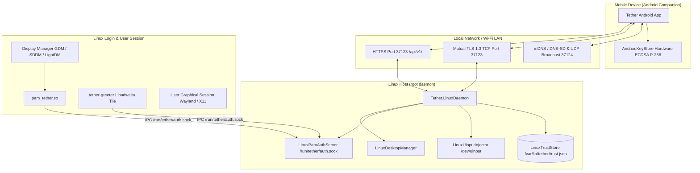

# Tether Linux Architecture & Design

## Overview
Tether Linux is a high-security, peer-to-peer desktop companion service enabling seamless cryptographic authentication, hardware telemetry, input injection, file transfer, remote terminal access, and desktop screen sharing between an Android mobile device and a Linux host.

---

## Core Subsystems

### 1. Network Discovery & Transport
- **mDNS / DNS-SD:** Advertises `_tether._tcp` service with host fingerprint and capabilities on port 37123.
- **UDP Broadcast:** Listens on port 37124 for discovery announcements from the Android mobile device.
- **Mutual TLS 1.3 Listener:** Operates on port 37123 using a machine-bound self-signed ECDSA certificate generated by `LinuxIdentity`.
- **Packet Router:** Dispatches binary input frames (type 0x05) directly to `LinuxUinputInjector` and JSON command/telemetry frames to `LinuxPacketRouter`.

### 2. Authentication & PAM Integration
- **Socket:** Domain socket at `/run/tether/auth.sock` with mode `0666` and directory `0755 root:root`.
- **Peer Verification:** Kernel-enforced `SO_PEERCRED` checks verify the caller process UID.
- **Service Whitelist:** Enforces that only authorized display manager services (`gdm-password`, `sddm`, `lightdm`, `login`, `tether-greeter`, `tetherctl-unlock`) can consume mobile unlock grants.
- **Native Password Fallback:** When no mobile unlock grant is armed, `pam_tether.so` immediately returns `PAM_AUTHINFO_UNAVAIL`, smoothly handing execution to the native password module (`pam_unix.so`).

### 3. Synthetic Input Injection
- **Virtual Input Devices:** Created via the Linux kernel `/dev/uinput` interface (`LinuxUinputInjector`).
- **Input Channels:** High-throughput bounded channels (2048 packets) drop oldest frames under extreme pressure to prevent input latency.
- **Relative & Absolute Pointer:** Supports relative mouse movements, mouse buttons, vertical and horizontal scrolling.
- **Virtual Keyboard:** Maps Windows virtual key codes and Unicode characters to Linux input event codes (`KEY_A`, `KEY_ENTER`, etc.) with automatic shift-state injection.

### 4. Desktop Screen Streaming & Window Management
- **MJPEG Streaming:** Continuous stream at `/api/desktop/stream` with multipart boundary `--frame`.
- **Screenshot Capture:** Instant JPEG snapshot at `/api/desktop/screenshot`.
- **Window Enumeration:** Window listing at `/api/desktop/windows` using `wmctrl` and user session info.
- **Cryptographic Client Proof:** All streaming and desktop endpoints require `X-Tether-Client-Proof` and `X-Tether-Client-Timestamp` headers signed by the paired mobile phone.

### 5. Hardware & Telemetry Control
- **Audio Control:** Non-blocking PipeWire / WirePlumber (`wpctl`) integration with fallback to `pactl`. Supports master volume, microphone gain, mute toggles, and audio sink/source enumeration.
- **Brightness Control:** Uses `brightnessctl` or direct `/sys/class/backlight` interfaces.
- **Battery & Power State:** Reads `/sys/class/power_supply` for battery capacity and charging status.
- **Emergency Panic Lockdown:** Immediately mutes system audio and calls `loginctl lock-session`.
