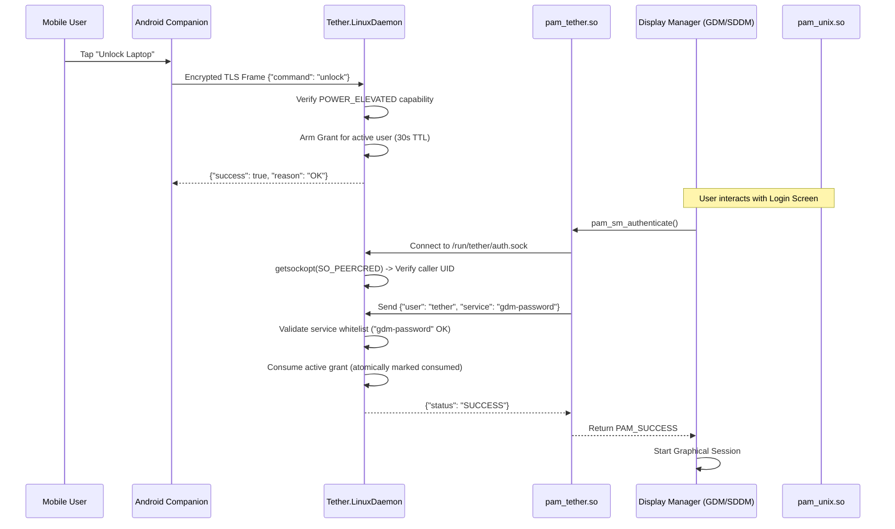

# Tether Linux PAM Security & Authentication Model

## Design Principles
1. **Fail-Closed by Default:** Any socket communication error, timeout, malformed message, or credential mismatch immediately terminates authentication with `PAM_AUTHINFO_UNAVAIL` or `PAM_AUTH_ERR`.
2. **Service Whitelisting:** Grants issued by a mobile unlock gesture can ONLY be consumed by authorized display manager services (`gdm-password`, `sddm`, `lightdm`, `login`, `gdm`, `tether-greeter`, `tetherctl-unlock`). They CANNOT be hijacked by `sudo`, `su`, or `sshd`.
3. **Kernel-Enforced Peer Verification:** Socket peer identity is verified using the Linux kernel `SO_PEERCRED` socket option.
4. **Zero Lingering State:** Unlock grants are strictly single-use and expire automatically after 30 seconds.
5. **Seamless Fallback:** When no mobile unlock is active, the PAM module returns `PAM_AUTHINFO_UNAVAIL` rather than `PAM_AUTH_ERR`, allowing the PAM stack to fall through to `pam_unix.so` without incrementing failure counters.

---

## The PAM Communication Flow



---

## Negative Security Paths

### 1. Attacker Attempts Grant Theft via `sudo`
1. Mobile user taps "Unlock Laptop" on phone.
2. Local non-root user executes `sudo -u tether some_command`.
3. `sudo` PAM stack invokes `pam_tether.so` with service `sudo`.
4. `LinuxPamAuthServer` evaluates `service`:
   ```csharp
   if (!_permittedServices.Contains(service))
   {
       _logger.Warning($"LinuxPamAuthServer: Rejected unlock request for unauthorized service '{service}'.");
       return new { status = "SERVICE_DENIED" };
   }
   ```
5. `pam_tether.so` receives `SERVICE_DENIED` and returns `PAM_AUTHINFO_UNAVAIL`.
6. `sudo` falls back to requiring user password. The mobile unlock grant remains untouched for GDM.

### 2. Peer Credential Mismatch or Failure
1. Caller connects to `/run/tether/auth.sock`.
2. `pam_tether.c` queries socket peer credentials:
   ```c
   struct ucred ucred;
   socklen_t len = sizeof(ucred);
   if (getsockopt(sock_fd, SOL_SOCKET, SO_PEERCRED, &ucred, &len) < 0) {
       pam_syslog(pamh, LOG_ERR, "SECURITY ALERT: Failed to read peer credentials.");
       close(sock_fd);
       return PAM_AUTHINFO_UNAVAIL;
   }
   ```
3. If caller UID is not root (`0`) and does not match caller UID, the connection is aborted immediately.

---

## PAM Configuration Reference

### Fedora / RHEL / CentOS (`/etc/pam.d/gdm-password`)
```pam
auth     [success=done ignore=ignore default=bad] pam_selinux_permit.so
auth     sufficient    pam_tether.so
auth     substack      gdm-password-auth-substack
-auth    optional      pam_gnome_keyring.so
-auth    optional      pam_oo7.so
auth     include       postlogin
```

### Ubuntu / Debian (`/etc/pam.d/gdm-password` or `/etc/pam.d/lightdm`)
```pam
auth     sufficient    pam_tether.so
@include common-auth
-auth    optional      pam_gnome_keyring.so
@include common-account
@include common-session
```
