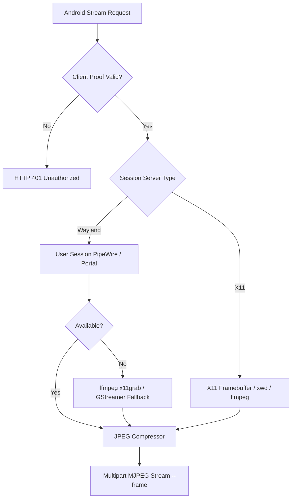

# Tether Linux Desktop Screen Sharing & Remote View

## Overview
Tether Linux implements high-performance desktop screen sharing, screenshot capture, and running application window enumeration designed for seamless consumption by the Android companion app's `RemoteDesktopScreen`.

---

## Streaming Protocol & Endpoints

All desktop streaming endpoints run over HTTP/TLS on port 37123 and require client cryptographic proof:

| Endpoint | Method | Response Content-Type | Description |
| :--- | :--- | :--- | :--- |
| `/api/desktop/stream` | GET | `multipart/x-mixed-replace; boundary=--frame` | Live MJPEG continuous desktop stream (up to 30 FPS). |
| `/api/desktop/screenshot` | GET | `image/jpeg` | Instant full-resolution desktop snapshot. |
| `/api/desktop/windows` | GET | `application/json` | List of running application windows with IDs, titles, and PIDs. |

---

## Cryptographic Client Proof Authentication
To prevent unauthorized network entities from accessing the desktop stream, all requests MUST include cryptographic proof headers signed by the paired Android companion device's private ECDSA P-256 key:

```http
GET /api/desktop/stream HTTP/1.1
Host: 192.168.1.100:37123
X-Tether-Client-Proof: MEQCIEv3vK9f2pP... (Base64 ECDSA Signature)
X-Tether-Client-Timestamp: 1732398000000
```

### Signature Validation Invariant
1. Signature string: `GET /api/desktop/stream:<timestamp>`.
2. Timestamp skew check: `|UtcNow - ClientTimestamp| <= 300 seconds`.
3. Signature verification: Validated using the paired device's pinned public key in `LinuxTrustStore`.
4. If invalid or missing, server returns `HTTP 401 Unauthorized` immediately without processing frames.

---

## Capture Pipeline & Fallbacks



### Frame Encoding
- Format: Progressive JPEG.
- MJPEG Boundary: `--frame` matching the Android client parser in `RemoteDesktopScreen.kt`.
- Quality: Default 75% quality for optimal balance between network bandwidth and clarity.
- Frame Rate: Dynamically throttled between 15 and 30 FPS depending on network latency.
