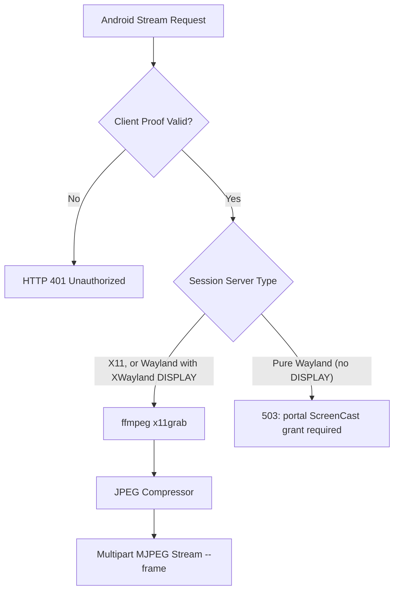

# Tether Linux Desktop Screen Sharing & Remote View

## Overview
Tether Linux implements high-performance desktop screen sharing, screenshot capture, and running application window enumeration designed for seamless consumption by the Android companion app's `RemoteDesktopScreen`.

---

## Streaming Protocol & Endpoints

All desktop streaming endpoints run over HTTP/TLS on port 37123 and require client cryptographic proof:

| Endpoint | Method | Response Content-Type | Description |
| :--- | :--- | :--- | :--- |
| `/api/desktop/stream` | GET | `multipart/x-mixed-replace; boundary=--frame` | Live MJPEG continuous desktop stream (up to 30 FPS). |
| `/api/desktop/screenshot` | GET | `image/jpeg` | Instant full-resolution desktop snapshot. |
| `/api/desktop/windows` | GET | `application/json` | List of running application windows with IDs, titles, and PIDs. |

---

## Cryptographic Client Proof Authentication
To prevent unauthorized network entities from accessing the desktop stream, all requests MUST include cryptographic proof headers signed by the paired Android companion device's private ECDSA P-256 key:

```http
GET /api/desktop/stream HTTP/1.1
Host: 192.168.1.100:37123
X-Tether-Client-Proof: MEQCIEv3vK9f2pP... (Base64 ECDSA Signature)
X-Tether-Client-Timestamp: 1732398000000
```

### Signature Validation Invariant
1. Signature string: `<transferToken>:<timestampMs>:<hostSpki>`, signed with the paired phone's ECDSA P-256 key.
2. Timestamp skew check: `|UtcNow - ClientTimestamp| <= 5 minutes`.
3. Replay protection: a proof signature is accepted only once inside the skew window.
4. The token must be bound to a paired device fingerprint present in `LinuxTrustStore`, and the proof
   must verify against that device's pinned public key.
5. If any check fails, the server returns `HTTP 401 Unauthorized` without processing frames.

---

## Capture Pipeline & Limitations



**Wayland:** native Wayland compositors expose screen content only through the XDG Desktop Portal
`ScreenCast` interface, which returns a PipeWire stream after the user grants permission. Tether does
not yet implement that portal client, so pure-Wayland sessions return `503` with an explanatory
message instead of capturing. Tether deliberately does **not** fall back to root DRM/KMS (`kmsgrab`)
capture, because that would bypass the compositor's security model and record content the user never
consented to share. Wayland desktops that also run XWayland (the default for GNOME and KDE) can still
be captured through `DISPLAY`, limited to XWayland windows.

**X11:** capture uses `ffmpeg -f x11grab` with the active session's `DISPLAY`/`XAUTHORITY`. When
`ffmpeg` is missing or the capture fails, the endpoint returns an error rather than a synthetic frame.

### Frame Encoding
- Format: Progressive JPEG.
- MJPEG Boundary: `--frame` matching the Android client parser in `RemoteDesktopScreen.kt`.
- Quality: Default 75% quality for optimal balance between network bandwidth and clarity.
- Frame Rate: Dynamically throttled between 15 and 30 FPS depending on network latency.
